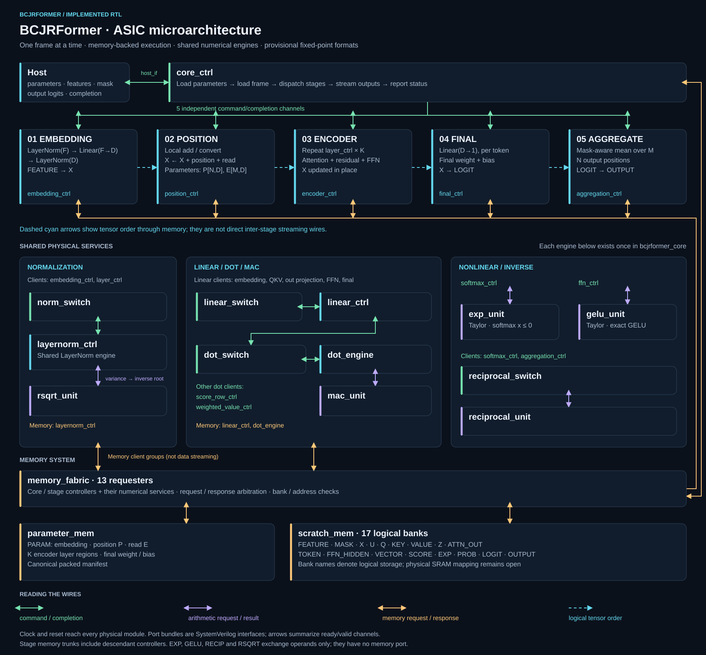

# ASIC-bcjrformer

**BCJRFormer ASIC architecture, microarchitecture, and SystemVerilog implementation.**

Five processing stages, shared arithmetic services, and an explicit memory-backed schedule. This repository brings together the complete project: RTL, architecture and microarchitecture, editable diagrams, technical reports, presentations, interactive explorers, supporting tools, and verification sources.

[Architecture](docs/architecture.md) · [Microarchitecture](docs/microarchitecture.md) · [Project library](docs/project-library.md) · [Trained-frame validation](#trained-frame-validation) · [Quick start](#quick-start) · [Verification](docs/verification.md) · [Numerics](docs/numerics.md)

For shared development, follow the [Git collaboration workflow](docs/collaboration.md): update before editing, commit and push reviewed changes, and use separate branches for concurrent work.

## Microarchitecture



The stages run in sequence for one frame. Encoder layers and attention heads reuse hardware through controller loops. Stage boundaries are completion barriers over committed memory writes; they are not five simultaneously executing pipeline stages.

| Stage | Operation | RTL entry point |
|---|---|---|
| 1 · Embedding | Normalize input, project F → D, normalize embedding | [embedding_ctrl](rtl/control/embedding_ctrl.sv) |
| 2 · Position | Add position and read embeddings | [position_ctrl](rtl/control/position_ctrl.sv) |
| 3 · Encoder | K pre-norm attention/FFN layers, with residuals | [encoder_ctrl](rtl/control/encoder_ctrl.sv) |
| 4 · Projection | Map each token to one logit | [final_ctrl](rtl/control/final_ctrl.sv) |
| 5 · Aggregation | Average valid reads separately for each position | [aggregation_ctrl](rtl/control/aggregation_ctrl.sv) |

The complete assembly is [bcjrformer_core.sv](rtl/bcjrformer_core.sv). Start with the [reading guide](docs/README.md) for interfaces, memory, and controller details.

## Project status

**Implemented research baseline; numerical formats remain provisional.** All 29 public module kinds have implementations. EXP and GELU use Taylor arithmetic with documented Lagrange remainder bounds, rather than function-value lookup tables.

The [17 October critical review](docs/reviews/RTL-CRITICAL-REVIEW-2026-10-17.md) findings are addressed by the [corrective RTL revision](docs/rtl/RTL-REVIEW-FIXES-2026-10-17.md): exact LayerNorm statistics, F22 GELU storage/consumption, synthesis configuration guards and stronger regressions. Fresh checks include 16 complete frames, 2705 compared writes, 958 arithmetic vectors, 53 LayerNorm cases and 22 targeted controller scenarios. The first trained-frame result is recorded below. Broader numerical validation and physical sign-off remain open.

Recorded implementation checks from 16 October 2026:

| Check | Recorded result |
|---|---|
| Complete and protocol elaboration | 0 errors, 0 warnings |
| Complete-core execution | 12 fixture frames; 2,497 checked intermediate writes |
| Arithmetic services | 847 vectors |
| Connected faults and recovery | 4 scenarios |
| Fixed-point conversion | Exhaustive signed48/F20 → signed16/F10 proof |

These results come from the [archived evidence](docs/evidence/implementation-2026-10-16.json), with production source hashes. They do not establish trained-model accuracy, full-size execution, four-state simulation coverage, FPGA/ASIC area, or timing closure. The [verification guide](docs/verification.md) explains the scope and reproduction procedure.

## Trained-frame validation

**All 144 RTL output words matched the fixed-point Python reference exactly on the first trained frame.** This was a simulation of the integrated SystemVerilog core at the trained dimensions. The RTL completed successfully on 6 November 2026. [Detailed run record](docs/evidence/trained-frame-validation-2026-11-06.md)

### From the research to the RTL

BCJRFormer addresses insertions, deletions, and substitutions in noisy reads. Insertions and deletions can shift the read out of alignment with the transmitted codeword. The research uses a BCJR-inspired sliding-window representation so the Transformer can use information across positions and, when available, across multiple reads. We used the upstream PyTorch implementation of the binary marker-code inner decoder to determine the actual operation order, tensor shapes, weight layout, and attention behavior. The RTL starts at the windowed feature tensor and padding mask and ends at one logit per encoded position. Software handles raw-read preprocessing and outer-code decoding. [Upstream BCJRFormer](https://github.com/streit-julian/BCJRFormer) · [RTL architecture](docs/architecture.md)

### How we generated the expected outputs

1. **Select a captured frame.** We used sample 0 from a ten-frame capture for the epoch-94 checkpoint. It has one read, 144 positions, and 27 input features per position. The model has width 96, eight attention heads, and six encoder layers. The selected frame has no padded positions.
2. **Convert the saved parameters and inputs.** A local converter mapped PyTorch tensors to the [RTL parameter manifest](rtl/scripts/parameter_manifest.py), preserving their row-major layout. It multiplied each weight, bias, and feature by 1024, rounded to the nearest integer with ties to even, and clamped to the signed 16-bit range. No values needed clipping. The resulting parameter image contained 687,991 words from 106 tensors.
3. **Compute new logits in Python.** The [fixed-point reference](rtl/tests/fixed_reference.py) ran inference on the quantized words. It uses the same intermediate widths and rounding points specified for the RTL. The original PyTorch logits were used only as a separate comparison. All 144 decoded bits agreed with PyTorch, with a mean absolute logit difference of 0.019557 and a maximum of 0.068535.

### How we checked the hardware

YoWASP Yosys with slang elaborated the [production SystemVerilog sources](rtl/protocol/files.f) and [simulation wrapper](rtl/tests/core_sim_top.sv). We set the wrapper dimensions to `(F, M, N, D, H, K) = (27, 1, 144, 96, 8, 6)`. Yosys CXXRTL generated the C++ model, and G++ compiled it for the Windows run.

The test driver sent every parameter word through the RTL host interface and waited for each write acknowledgment. It committed the parameter image, sent the same quantized features and padding mask that Python used, then checked each signed output word and its position. For example, position 0 produced `-680` in both RTL and Python. Dividing by 1024 gives `-0.6640625`, compared with the saved PyTorch logit of approximately `-0.660010`.

| Check | Result |
| --- | --- |
| RTL vs. fixed-point Python | **144/144 exact signed integer matches** |
| RTL completion | Code 0, with rounding recorded and no saturation or fatal errors |
| Simulation duration | 1,533,280,239 simulated cycles, about 8 hours 7 minutes on the Windows PC |

### Repeat the comparison

Use the same RTL wrapper and dimensions in your simulator. Load the local parameter image, send the same feature words and padding mask over the ready/valid interface, and require successful completion plus an exact match at every output position. The [run record](docs/evidence/trained-frame-validation-2026-11-06.md) lists the setup and pass criteria. The checkpoint, parameter image, input frame, and per-position output files are kept outside Git and must be supplied separately to repeat this exact run. The public fixtures under [Quick start](#quick-start) can run with the checkout alone.

The result covers the final outputs for one unpadded, single-read frame. The remaining captured frames, trained multi-read and padding cases, and decoding accuracy across a larger dataset are still open. The RTL's per-position aggregation reports `EMPTY_POSITION` when a position has no valid reads. The upstream single-read path bypasses aggregation, so that behavior needs a dedicated test.

## Quick start

Prerequisites: Python 3.12, Node.js 22 or newer, and the Python packages pinned in [requirements-dev.txt](requirements-dev.txt). Publication checks used Python 3.12.14 and Node.js 24.19.0. Tool binaries, model checkpoints, and weights are not bundled.

From the repository root:

```sh
python -m venv .venv
# Activate .venv using your shell's normal activation command.
python -m pip install -r requirements-dev.txt
python scripts/check.py smoke
```

`smoke` elaborates both integration fixtures, checks the module connection inventory, and exercises the parameter-manifest round trip. For the Taylor bounds and integer-reference accuracy sweeps:

```sh
python scripts/check.py numerics
```

For the complete implementation regression, including lowered-RTL cycle tests and bounded proofs:

```sh
python scripts/check.py full
```

The full run generates netlists and logs locally and may take considerable time. See [verification](docs/verification.md) for the individual commands and limitations.

## Configuration

Set `F`, `M`, `N`, `D`, `H`, and `K` explicitly at elaboration; their default zero values intentionally reject an unspecified model. Require `D % H == 0`. The canonical parameter manifest and memory capacities are derived from these dimensions.

This small example is a **test fixture**, not a selected trained configuration:

```sh
python rtl/scripts/parameter_manifest.py --f 2 --m 2 --n 2 --d 2 --h 1 --k 2 --out manifest.json
```

The exporter accepts raw signed Q10 tensors through `--tensor-json` and `--image`; it checks names, sizes, and integer ranges. It does not quantize a floating-point checkpoint. Static attention masks are not supported by this baseline.

## Repository map

```text
rtl/
  bcjrformer_core.sv    Complete assembly
  control/             Stage, layer, attention, and shared-service controllers
  arithmetic/          Fixed-point helpers and numerical units
  interfaces/          Types, ready/valid interfaces, and public declarations
  memory/              Behavioral parameter and scratch stores
  protocol/            Switches, fabric, and ordered production source list
  scripts/             Contract and parameter-manifest tools
  tests/               Integer reference, cycle interpreter, fixtures, proofs
docs/
  images/              Microarchitecture artwork and editable source
  rtl/                 Detailed contracts and dated implementation checkpoints
  architecture/        Historical detailed architecture drafts
  evidence/            Recorded source-hashed verification summary
diagrams/              Editable stage and microarchitecture diagrams
images/                Stage, FSM, and shared-block exports
presentation/          Project decks and speaker notes
web/                   Standalone interactive architecture and signal explorers
output/                Authored report PDF and historical architecture review
scripts/               Reproduction, publication checks, and supporting tools
```

## Next milestones

- Complete the joint RTL review and freeze a selected model/checkpoint and parameter manifest.
- Compare floating-point, bit-accurate, and RTL intermediate tensors and decoding results.
- Map behavioral memories and assess wide arithmetic against a selected FPGA/ASIC target.
- Establish full-size coverage and target-specific area, frequency, and throughput.

## Background and rights

Project authors: **Taimor Sabek and Haiel Bader**. The hardware follows the BCJRFormer model family; its working contracts document an explicit per-position aggregation correction. Model/reference code is maintained separately and is not vendored here. See [provenance and rights](NOTICE.md) before reuse.

The presentation is inspired by the clear microarchitecture-first structure of [ama-riscv](https://github.com/AleksandarLilic/ama-riscv). Its code and artwork are not included.

The project is publicly viewable under the [Viewing and Prior Written Permission License](LICENSE.md). **Consult Taimor Sabek and Haiel Bader and obtain their written permission before using, simulating, synthesizing, modifying, or redistributing the original project materials**, including for research or non-commercial work. Request permission through a GitHub issue titled **Permission request**. Third-party materials retain their own licenses; see [NOTICE.md](NOTICE.md). This is a public, source-available project under a custom restrictive license.
