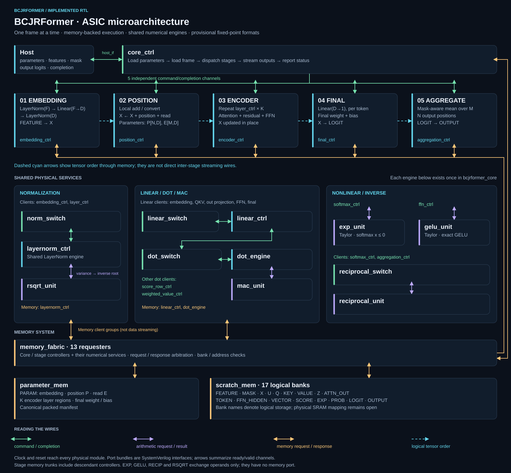
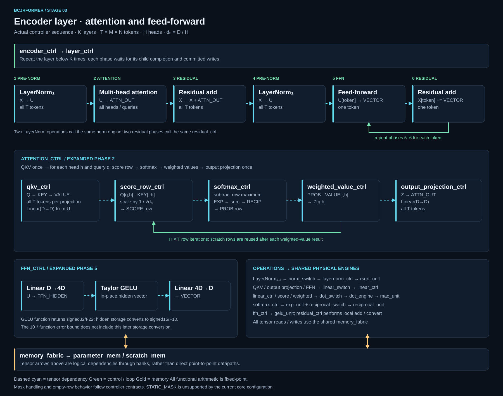

# BCJRFormer microarchitecture diagrams

The diagrams describe the implemented `bcjrformer_core` assembly, including the Taylor EXP/GELU revision. They use a dark background, stage names, orthogonal wires, and a compact color legend.

| View | SVG | Editable diagrams.net source | Raster preview |
| --- | --- | --- | --- |
| Complete core | [Overview](bcjrformer-microarchitecture.svg) | [Draw.io](bcjrformer-microarchitecture.drawio) | [PNG](bcjrformer-microarchitecture.png) |
| Encoder layer | [Encoder detail](bcjrformer-encoder-detail.svg) | [Draw.io](bcjrformer-encoder-detail.drawio) | [PNG](bcjrformer-encoder-detail.png) |





## Reading the diagrams

- Green wires summarize command/completion channels; purple wires summarize arithmetic request/result channels. Double arrows combine the forward request and returning response, including their ready/valid handshakes.
- Gold wires summarize memory requests and responses. Group trunks combine several requesters for readability; they are not extra RTL buses. In particular, the stage-3 trunk includes its child controllers and shared computation is shown separately.
- Dashed cyan arrows describe logical tensor dependencies through memory. They do not represent direct streaming connections, register boundaries, or five concurrently active pipeline stages.
- The complete-core view shows one physical instance of each shared engine. Client labels replace some service-call wires to keep the overview readable. There are two norm clients, five linear clients, three dot clients, and two reciprocal clients.
- The encoder view shows scheduled operations. Its two LayerNorm boxes use the same physical `layernorm_ctrl`, and the residual phases use one `residual_ctrl`. The linear operations also share one `linear_ctrl`, `dot_engine`, and `mac_unit`.
- All physical blocks share clock/reset. Those global wires and per-bit signal widths are omitted. Exact payload types and handshake details remain in the SystemVerilog interfaces.

The 13 actual memory clients are `core_ctrl`, `embedding_ctrl`, `position_ctrl`, `attention_ctrl`, `layernorm_ctrl`, `linear_ctrl`, `score_row_ctrl`, `softmax_ctrl`, `weighted_value_ctrl`, `ffn_ctrl`, `residual_ctrl`, `aggregation_ctrl`, and `dot_engine`. EXP, GELU, RECIP and RSQRT units have no direct memory interface.

## Accuracy and scope

Sources checked: `rtl/bcjrformer_core.sv`, `rtl/RTL-CONNECTIONS.md`, `rtl/interfaces/bcjrformer_contract_pkg.sv`, and the layer, attention, embedding, FFN, position and aggregation controller implementations. The main view lists all 18 logical banks, comprising PARAM plus 17 scratch banks. Stage order, phase barriers, `H × T` attention-row loops and per-token FFN/residual loops follow the controllers.

GELU's function output and FFN hidden storage retain signed32/F22, preserving the function's 10^-5 absolute error target for represented inputs. The consuming linear operation uses signed64/F32 accumulation, then converts its output to signed16/F10 under a separate output-conversion contract. Initial signed16/F10 preactivations are promoted exactly to hidden-bank F22 storage before GELU. Physical SRAM mapping, area and timing remain to be established; “ASIC microarchitecture” identifies the project scope, not a completed technology implementation.

## Editing and regeneration

Open either `.drawio` file in diagrams.net to move individual boxes, text and wire vertices. SVG is also editable in a vector editor. The deterministic generator uses the Python standard library:

```text
python diagrams/microarchitecture/build_diagrams.py
```

That command regenerates SVG and draw.io sources, replacing manual changes to those generated files. To keep a layout change reproducible, change the generator. PNG previews can be regenerated with any SVG rasterizer; the checked-in previews were rendered at native SVG resolution with Sharp and visually inspected.

These images are documentation artifacts and do not change the RTL or verification results.
