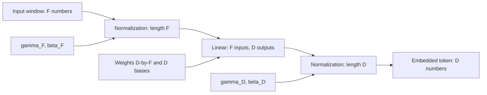
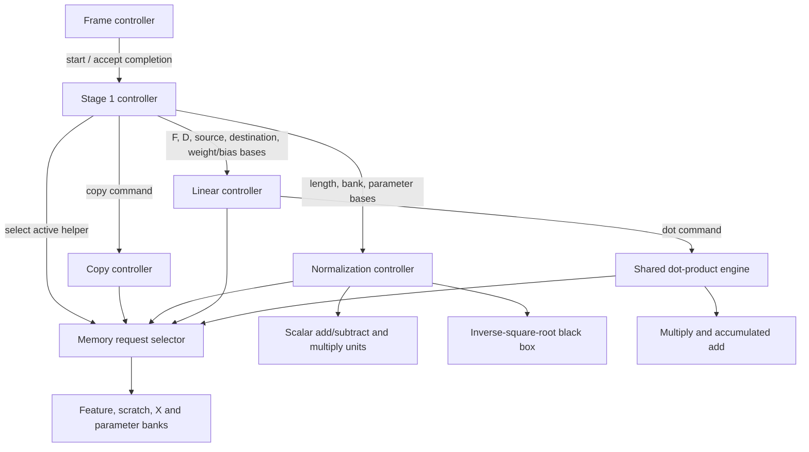
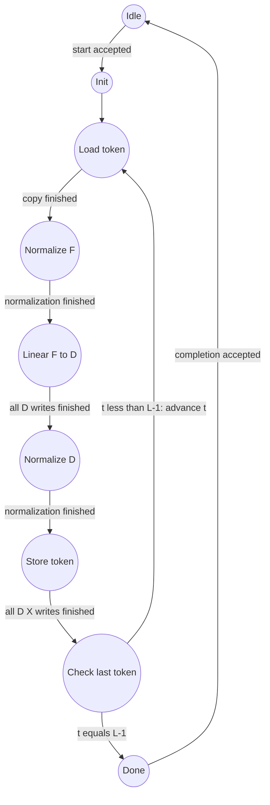

# BCJRFormer inference core: RTL specification draft

> Current implementation/numerical-method update, 16 October 2026: all public RTL blocks are implemented. EXP and GELU now use Taylor arithmetic with Lagrange-derived absolute error budgets below 10^-5 at the function outputs; no function-value ROMs are used. GELU returns signed32/F22 `gelu_t`, then FFN explicitly converts to signed16/F10 activation storage. The former signed16 GELU response, +/-8 tail method, and older primitive accuracy proposals below are superseded by `RTL-TAYLOR-CHECKPOINT.md`. See also `RTL-COMPLETE-CHECKPOINT.md`; numerical/decoding calibration and physical sign-off remain open.

> Implementation update, 10 October 2026: the structural architecture checkpoint was approved. Protocol, memory adapters and host/core control are now implemented; see `RTL-PROTOCOL-CHECKPOINT.md`, `RTL-MEMORY-CHECKPOINT.md` and `RTL-CORE-CHECKPOINT.md`. Earlier approval/implementation notices below describe historical drafting stages. Numerical verification and processing RTL remain unfinished.

> Current review entry point (10 October 2026): ARCHITECTURE-CHECKPOINT-1.md. Working stage and interface contracts take precedence over older generated publication snapshots. Numerical verification is pending Haiel; this checkpoint awaits Taimor's approval.

Amit approved the initial architecture document; his comments and corrections are pending. Detailed datapaths, memory banks and control paths are now being refined stage by stage. RTL implementation and numerical validation remain unfinished.

This Markdown file is the working specification. Stages 1 and 2 have detailed working designs and draw.io diagrams; Stages 3–5 follow their detailed companion. Phase-1 consolidation aligns the compact encoder/FFN schedules and corrected per-position aggregation with those working designs. All await review; numerical sizes and formats remain candidates. Keep dimensions symbolic during this pass. See `ARCHITECTURE-CHECKPOINT-1.md` for the current approval gate and historical-publication limits.

## Scope and evidence

Detailed Stages 3–5 are now drafted in `Stages3-5-design.md`, with all stages assembled in `BCJRFormer_all_stages.drawio`. That companion supplies the completed working diagrams, memory/control rules and corrected Stage 5 behavior. It takes precedence over older compact schedules below where they differ; it awaits our review, not numerical sign-off.

Inputs are prepared window features and a padding mask. Outputs are binary logits. Window generation, training, hard decisions and outer decoding are outside the core. All five software stages are included. Dropout is disabled for inference.

Source: `BCJRFormer/bcjrformer/models/bcjrformer.py`, especially constructor and forward; `BCJRFormer/bcjrformer/models/modules.py`, especially MultiHeadedAttention, FeedForward, SelfAttentionLayer and TransformerEncoder. The example model YAML has D=16, H=2, N_dec=1 and M=1. It does not prove the configuration of a trained checkpoint.

## Proposed configuration

One frame at a time, B=1. Compile-time parameters: N encoded positions, M read slots, F window features, D model width, H heads, K encoder layers; L=M*N and d=D/H. Require all dimensions positive and D divisible by H. Preserve the general M>1 path even if the first test uses M=1. N and F must be selected with the dataset/checkpoint, not guessed from the model YAML.

Use sequential arithmetic and one exclusive shared dot-product engine. Keep all Q/K/V vectors for a layer, but only one attention score row. Do not parallelize layers or frames in this baseline. The same encoder hardware iterates over layers with different parameter bases.

Numerical proposal, pending calibration: signed 16-bit stored activations and weights with 10 fractional bits (range -32 to 31.9990234375). Standard linear and QK dot products use a signed 48-bit accumulator with 20 fractional bits. Products are exact 32-bit signed values before extension. Biases are stored at 16/10 and shifted left by 10 before accumulator initialization. The same physical engine also supports a 24-bit unsigned probability times a 16-bit signed value; zero-extend probabilities before multiplication and use a signed 64-bit accumulator with 32 fractional bits for weighted values. Set the physical accumulator width to 64 and sign-extend the standard 48-bit mode while checking its declared range. Round to nearest, ties to even, then saturate on narrowing. Record saturation and accumulator-overflow flags. This format is a starting experiment, not an accuracy claim. Wider formats and per-tensor scales may be needed.

LayerNorm means use signed 32-bit/20-fraction values. Centered differences use signed 40-bit/20-fraction values, with 80-bit full products and 96-bit/40-fraction variance accumulation before division by V. Variance plus epsilon is unsigned 48-bit/32-fraction at the rsqrt interface. Represent softmax exponentials and probabilities in unsigned 24-bit/22-fraction format, with a 64-bit/22-fraction sum. Score rows use signed 48-bit/20-fraction values, retaining QK precision through scaling (not 16-bit narrowing). All reductions check overflow. Compile-time bounds: V<=65535, L<=65535, and d<=65535; reject larger configurations. These are proposed numeric bounds, not practical SRAM capacity targets. Precision adapters are explicit operations; epsilon is round(1e-5 * 2^32)/2^32 and must not round to zero. Implementing the wide scalar path serially is allowed; it is distinct from the shared matrix dot engine. Accuracy must be established by bit-accurate tests before RTL is frozen.

## Common transaction protocol

### Scalar arithmetic and constants

For the proposed bit-accurate baseline, constants are elaboration-time values rounded to nearest, ties to even: 1/F and 1/D use unsigned40/32; 1/sqrt(d) uses unsigned32/30; the uniform attention probability 1/L uses unsigned24/22. They are not learned weights. Runtime 1/C uses the reciprocal unit after checking C>0.

LayerNorm sum is signed48/10. Multiply by unsigned40/32 (zero-extended for signed arithmetic), retaining a signed89/42 product, then round to signed32/20 mean. Center by extending the input to signed40/20. Accumulate full centered squares in unsigned96/40; multiply the variance sum by unsigned40/32 using a full unsigned136/72 intermediate, then round to unsigned48/32 and add epsilon. Such wide intermediate registers may be implemented by a serial scalar datapath; they do not travel through the 96-bit memory adapter. Multiply centered signed40/20 by zero-extended rsqrt unsigned32/20 to signed73/40; round to signed32/20 normalized value. Multiply by signed16/10 gamma to signed48/30, add beta extended to signed49/30, then round/saturate to signed16/10. All intermediate range violations raise numerical error rather than silently wrapping.

Scale signed48/20 QK scores by unsigned32/30 using signed81/50 full multiplication, then round to signed48/20. Subtract the row maximum in signed49/20; compare with -16 before narrowing the retained exp input to signed48/20. Normalize unsigned24/22 exponentials with unsigned40/32 reciprocal through unsigned64/54, then round to unsigned24/22. Independent probability rounding need not sum exactly to one; measure that error in verification. Aggregate unmasked logits using signed48/10 sum; multiply by runtime unsigned40/32 reciprocal into signed89/42, then round/saturate to signed16/10. Position and residual additions use signed17/10 before narrowing. The final logit storage proposal is signed16/10. These are explicit draft rounding points, not proof of equivalence to floating-point inference.

All modules use clk and synchronous active-high rst. On reset: deassert output valid, clear busy/counters/ownership and invalidate configuration/frame state. Memory contents need not clear because valid flags prevent reads of stale data.

Commands use cmd_valid/cmd_ready. Capture descriptors only when both are high. Only one command is outstanding per engine. Results use rsp_valid/rsp_ready with rsp_error; hold response and error stable until accepted. A response indicates all commanded writes have committed, not merely that arithmetic has started. Address/data requests and responses each use ready/valid. Counters advance on accepted work or completed results, never on an unaccepted request. If stalled, hold payload/address/control stable. No timeout is inferred; a diagnostic watchdog is optional and outside the baseline behavior.

Arithmetic primitives use req_valid/req_ready, operands and operation tag, followed by rsp_valid/rsp_ready, result and error. Latency may vary; controllers wait for the response. One outstanding request avoids tag-reordering logic. Fatal hardware/protocol/arithmetic errors latch at top level, stop new requests, drain accepted transactions, and produce one error completion; reset is required before retry. Stage 5 EMPTY_POSITION is a separate recoverable input error: discard the frame, retain parameters, and return to idle after host error acceptance without reset.

## Top-level ports and load order

`bcjrformer_core`: clk, rst; parameter-write channel `{valid,ready,addr,data}` and write acknowledgment `{valid,ready,error}`; parameter_commit; frame command `{valid,ready}`; feature input `{valid,ready,data,last}`; mask input `{valid,ready,bit,last}`; logit output `{valid,ready,data,index,last}`; completion `{valid,ready,error,code,position}`; busy; numerical-status flags. `RTL-interfaces.md` defines signal names and the proposed typed aggregation completion. Error codes distinguish OK, recoverable EMPTY_POSITION and FATAL; position identifies the first empty position and is zero otherwise.

Parameter writes are accepted only in IDLE before a frame, sequentially from address zero, with the exact manifest length. Reject out-of-order, duplicate and out-of-range addresses. parameter_commit is accepted only after all expected words have committed; any new load invalidates the old image. Host supplies the matching configuration manifest; a checksum is a verification/host responsibility. No run-time dimension changes.

parameter_commit is a one-cycle strobe legal only while IDLE after the last parameter write response; it has no ready signal. An illegal strobe latches a protocol error and requires reset. Frame-command ready is high only for a committed image with no outstanding parameter transaction and no parameter write/commit presented that cycle. Parameter writes take priority over frame commands. Top-level data widths are 16 for weights/features/logits, one for mask/last/valid/ready/error/busy, PARAM_ADDR_W for parameter address, and max(1,ceil(log2(N))) for output index. Feature and mask counters are sized from their complete bank lengths, not the 16-bit vector descriptor count. Status bits distinguish saturation (sticky, nonfatal), arithmetic overflow/domain error, and protocol error (fatal). Saturation clears at each accepted frame; fatal status clears only on reset.

After frame command acceptance: load L*F features in m,n,f order, then L mask bits in m,n order. Check last exactly at the specified final element. Early or missing last is a frame error. No feature/mask overlap is required. Compute starts after both loads. Output N logits in n order with last on n=N-1. Completion is asserted after the final output transfer; output backpressure must not discard or duplicate logits.

## Module hierarchy and contracts

| Module | Inputs / read ownership | Outputs / completion |
|---|---|---|
| core_ctrl | Complete frame and parameter image | Commands the five stages and emits logits |
| embedding_ctrl | Features [L,F]; three normalization/linear parameter sets | Stage 1 X [L,D] |
| position_ctrl | X, P[N,D], E[M,D] | In-place X+P+E [L,D] |
| encoder_ctrl | X and mask; layer parameter base | K layers completed, X [L,D] |
| layer_ctrl | One layer input X [L,D] | Updated layer output [L,D] |
| layernorm_ctrl | Vector length V (F or D), source/destination addresses, gamma/beta bases | One V-element normalized vector |
| linear_ctrl | Input length I, output length O, vector/weight/bias/output bases | O outputs, bias included |
| attention_ctrl | All normalized tokens U [L,D], padding mask, optional static mask | O [L,D] after output projection |
| softmax_ctrl | One L-element score row plus mask tags | One L-element probability row |
| ffn_ctrl | One normalized token [D], FFN parameters | One FFN token [D] |
| residual_ctrl | Two D-element vectors, destination | D committed sums |
| final_ctrl | Encoder tokens [L,D], final weights/bias | Per-read logits [L] |
| aggregation_ctrl | Logits [M,N] and original mask [M,N] | N logits and denominator status |
| dot_engine | I, operand-memory descriptors, accumulator initial value | One widened dot product |
| parameter_mem | Read address or idle-time host write | Parameter data / accepted write |
| scratch_mem | Exclusive owner requests | Read/write completion |
| exp_unit, reciprocal_unit, rsqrt_unit, gelu_unit | Numeric requests under the common protocol | Numeric result/error with bounded input domain |

Address widths are max(1,ceil(log2(depth))) for each bank. Counter widths must represent the terminating count (ceil(log2(count+1))), or use last-index comparisons without overflow. Parameter arithmetic uses elaboration-time constants and checks total address range.

Descriptor register contracts: layernorm={V,src,dst,gamma_base,beta_base}; linear={I,O,src,dst,W_base,b_base}; residual={V,left,right,dst}; attention={L,D,H,U_base,O_base,Q_base,K_base,V_base,Z_base,layer_param_base}; dot={I,A_base,A_stride,B_base,B_stride,mode,acc_init}; softmax={L,score_base,prob_base,padded_query}. Counts are 16-bit unsigned under the declared bounds; every descriptor count, including FFN length 4D and layer count K, must fit 1..65535. Bases and strides are BANK_ADDR_W unsigned; products of dimensions and all memory-size calculations use at least 64-bit elaboration/host arithmetic and must fit their bank. Descriptors are latched on command acceptance and immutable until completion. mode selects signed16xsigned16/20-fraction or unsigned24xsigned16/32-fraction accumulation. acc_init is signed64 in the selected binary point.

Memory requests carry valid, ready, write, bank, address, data and format; write responses acknowledge commitment and read responses carry data. Native banks use their declared width; the common adapter payload is 96 bits with unused upper bits zero on writes and canonical sign/zero extension on reads. Bank/format mismatches raise errors. Parameter words remain 16 bits except static-mask bits and the host-independent wider constants. No byte enables or burst ordering are required for the draft.

## Memory ownership and lifetime

| Storage | Elements | Lifetime / owner |
|---|---:|---|
| Feature memory | L*F | Load through completion of embedding |
| Padding bits | L | Whole frame; immutable during compute |
| X residual bank | L*D | Holds original layer input until attention residual addition; then holds r until FFN residual addition |
| U normalized bank | L*D | LayerNorm 1 output until Q/K/V creation completes |
| Q, K, V banks | 3*L*D | One complete attention layer |
| Z bank | L*D | Concatenated weighted-head outputs until output projection completes |
| Attention output bank | L*D | Output projection until residual addition |
| Token scratch | max(F,D) | Normalization or FFN input, exclusive sequential use |
| FFN hidden | 4D | One token's GELU outputs until second linear completes |
| Vector result scratch | max(D,4D) | Linear/normalization result, assigned exclusively |
| Score, exponential, probability rows | 3L | One head/query row; each has its own numeric format |
| Logits | L | Final projection through aggregation |
| Aggregated output | N | Aggregation through host transfer |

Add scalar scratch registers for mean, centered difference, squared value, variance, row maximum, widened row sum, reciprocal and loop indices. Optional static-mask storage contains L*L bits and is immutable during a frame. All listed banks are logically separate in this conservative draft; capacity reduction through aliasing requires a later lifetime proof.

Stage 1 uses token scratch for F-element input normalization in place: both statistics passes finish before any output overwrites its corresponding input. The F-to-D projection writes separate vector result scratch, followed by in-place D-element normalization there, then copies D results to X. FFN input scratch and hidden/result banks remain separate while needed. No linear command may alias its source and destination when future outputs still need the original source vector.

Proposed single-port synchronous banks, abstracted behind request/response adapters. Dot engine reads operand A, captures it, then operand B, captures it, then issues MAC and waits. It does not assume two reads per cycle. Banks may later be dual-ported without changing controller contracts. No other controller uses shared arithmetic or scratch while an owner command is outstanding.

Residual writes are in-place only after both operands at that address have been captured. All Q/K/V must exist before attention score evaluation. All head results for a token must exist before its output projection. All attention outputs are computed before overwriting X with first residual sums. FFN is then processed token by token; each r token survives until its own second residual addition commits.

Parameter tensors use software Linear layout W[out,in], row-major: base+out*I+in. Token address=t*D+i; t=m*N+n. Head component address=t*D+a*d+r. P address=n*D+i, E address=m*D+i. Layer parameters have distinct base addresses. A generated parameter manifest must list all tensor bases, shapes, formats and checksums. Parameter count in 16-bit words is 2F + DF + 3D + ND + MD + K*(12D^2+13D) + D+1: Stage 1 has two LayerNorms and an F-to-D linear; each encoder layer has four D-to-D projections, two FFN projections, and two LayerNorms; the final projection has D weights and one bias. Optional mask bits and numeric constants are separate. Sum bank sizes using their individual widths to obtain bit capacity once F,N,M,D,H,K are selected.

## FSM conventions

Every ISSUE state waits for request acceptance, every WAIT state waits for accepted completion, and every WRITE waits for memory acceptance/completion. The compact sequences below expand to those states where needed. No transition proceeds on busy alone. All terminal states hold response until accepted. Primitive errors take the error path described above.

On accepted command, clear the command's loop indices and reduction registers; latch immutable lengths and bases. Each nested-loop restart clears its inner index and accumulator before issuing work. Linear output accumulators initialize from the current bias, never the previous output. LayerNorm sum and variance sum clear separately before their passes; softmax maximum initializes from the first score (not zero), and exp sum clears before its pass. Aggregation clears sum and count at every new position n; the same inverse mask bit enables both logit addition and count increment while scanning m. No whole-slot validity reduction is used. Capture a memory or primitive result only on its response handshake; advance the associated index only once that operation's dependent write, if any, commits.

For attention, inner score-key index j resets for each (head a, query i); dot term index resets for each key. Weighted-value component r resets for each query; its dot term runs over j. On query completion: if i+1<L, increment i; else set i=0 and, if a+1<H, increment a; otherwise proceed to output projection. Output-token index restarts at zero. For the layer FFN loop, t restarts at zero after the first residual pass; for each next layer, all token/head/feature indices restart and only the parameter base advances. Every compact terminal DONE returns to command-ready IDLE only after response acceptance.

### Frame and encoder control

Core: IDLE -> LOAD_FEATURES -> LOAD_MASK -> EMBED -> POSITION -> ENCODER -> FINAL -> AGGREGATE -> OUTPUT -> COMPLETE -> IDLE. Each compute state launches once and waits. Feature/mask/output counters increment only on transfer. Bad packet counts or uncommitted parameters prevent compute.

Encoder: INIT_LAYER(k=0) -> RUN_LAYER -> WAIT_LAYER -> NEXT_LAYER. If k+1<K increment layer index and parameter base, otherwise DONE. One physical layer datapath is reused.

Layer: LN1_ALL_TOKENS -> ATTENTION -> RESIDUAL1_ALL -> LN2_ALL_TOKENS -> INIT_TOKEN -> FFN_TOKEN -> RESIDUAL2_TOKEN -> NEXT_TOKEN -> DONE. LN2 writes all normalized R tokens into reused U before the FFN/residual2 loop t=0..L-1. U's LN1 contents are dead before reuse. The mask is supplied only to attention; normalization/FFN do not skip padded tokens in compatibility mode.

### Shared linear and dot engines

Linear: INIT_OUTPUT(j=0) -> READ_BIAS -> DOT_COMMAND -> DOT_WAIT -> ROUND_SATURATE -> WRITE -> NEXT_OUTPUT. Repeat for j<O; complete after O committed writes. Dot: INIT_ACC -> READ_A -> READ_B -> MAC_ISSUE -> MAC_WAIT -> NEXT_TERM. Repeat i<I; return widened accumulator after the final term. This fixes sequential ordering without assuming a particular MAC latency.

### Stage 1 input embedding

#### Purpose

Turn the prepared window for each position in each read into the numbers used by the transformer. One **token** means one target position in one read. Stage 1 processes every token, including padded ones.

#### Definitions

| Symbol | Meaning |
|---|---|
| B | Independent frames processed together; our design uses B=1 |
| M | Read slots for one encoded sequence, including padded slots |
| N | Target bit positions per read, not the received read's length |
| W | Nearby received locations represented in a window |
| S | Candidate bit patterns represented at each window location |
| F=W*S | Input numbers in one window |
| L=M*N | Total read-position pairs, or tokens |
| D | Output numbers per token; the model width |
| m, n | Read and position indices, starting at zero |
| t=m*N+n | Token index, from 0 to L-1 |
| f, j | Input feature index (0 to F-1) and output feature index (0 to D-1) |

The dimensions describe the data sizes; they are not learned weights. Their actual values will be assigned later. F must match the Python model's `window_block_dimension`, and D must match `d_model`.

#### Data inputs

| Input | Shape / number of entries | Source | Used for |
|---|---|---|---|
| Prepared window features, y | [B,M,N,W,S]; L*F numbers for B=1 | Preprocessing, loaded into feature memory before Stage 1 starts | The input window for each token |
| First normalization scale and offset, gamma_F and beta_F | F numbers each | Trained parameters in parameter memory | Normalize the F input numbers |
| Embedding weights, W_emb | [D,F] | Trained parameters in parameter memory | Calculate each of the D weighted sums |
| Embedding bias, b_emb | D numbers | Trained parameters in parameter memory | Add a learned constant to each weighted sum |
| Second normalization scale and offset, gamma_D and beta_D | D numbers each | Trained parameters in parameter memory | Normalize the D projected numbers |

For a particular (m,n), the W-by-S table contains F numbers. Call these numbers x_t[f], with f selecting a location and candidate pattern in the stored table. This is an indexing description; it does not change the window values. The software treats the same data as [B,L,F].

The padding mask [M,N] belongs to the frame controller. Stage 1 does not read it to skip tokens or change its calculations. Keep it unchanged for attention and Stage 5.

#### Data output

| Output | Shape / number of entries | Destination | Meaning |
|---|---|---|---|
| Embedded values, e | [L,D]; L*D numbers | Working X bank, then Stage 2 | D numbers representing each read-position window |

The software result has shape [B,L,D]; B=1 is omitted from the hardware description. These output numbers are internal features, not decoded bits or logits. Stage 2 adds the trained position and read embeddings to them.

The arrays are stored in memory. They do not form an L-by-D group of wires between controllers. Stage 1 writes the result bank and reports completion; Stage 2 then reads that bank.

#### Control inputs and outputs

| Direction | Item | Meaning |
|---|---|---|
| Input | Clock and reset | Run the controller and return it to its reset state |
| Input | Start command | Request one complete Stage 1 run after the frame features and trained parameters are available |
| Input | Memory read responses | Supply requested feature and parameter values |
| Input | Arithmetic completion responses | Indicate that the requested normalization or linear calculation has finished |
| Input | Memory write responses | Confirm that requested output writes have finished |
| Output | Memory requests | Select the values to read or write |
| Output | Arithmetic commands | Start normalization or the linear calculation |
| Output | Completion or error status | Tell the frame controller whether Stage 1 finished successfully |

The precise signal names and bank addresses will be reviewed with the memory and control diagrams. A start is accepted once; the controller holds its completion until the frame controller accepts it.

#### Start and finish conditions

- Start only after all L*F input numbers are stored and the Stage 1 trained parameters are available.
- Process tokens in read order, then position order: t=m*N+n.
- Finish only after all L*D output writes are confirmed. A completed multiply alone does not mean the stage is complete.
- The frame controller starts Stage 2 after accepting successful Stage 1 completion.

#### Internal arithmetic: operations and connections

For each token: load F numbers -> normalize F numbers -> linear F-to-D calculation -> normalize D numbers -> store D numbers -> next token.

These are three steps in time. Both normalization steps use one shared normalization engine with different lengths and trained parameters. The linear step uses the shared dot-product engine. The arrows describe data dependencies; the next section will assign the intermediate values to memory banks.

##### Blocks 1 and 3: normalization

Use J=F for the first normalization and J=D for the second. Let a_i be input number i, with i from 0 to J-1.

| Step | Calculation | Basic operation |
|---|---|---|
| 1. Sum | sum = sum of all a_i | Add each input to a running sum |
| 2. Mean | mu = sum / J | Multiply by the stored constant 1/J |
| 3. Center | delta_i = a_i - mu | Subtract |
| 4. Square and sum | square_sum = sum of delta_i * delta_i | Multiply, then add to a running sum |
| 5. Variance | variance = square_sum / J | Multiply by the stored constant 1/J |
| 6. Add epsilon | q = variance + epsilon | Add a small positive constant |
| 7. Inverse square root | scale = 1 / sqrt(q) | Black box for now |
| 8. Normalize | normalized_i = (a_i - mu) * scale | Subtract, then multiply |
| 9. Learned scale and offset | output_i = normalized_i * gamma_i + beta_i | Multiply, then add |

The mean is the average input value. Variance is the average squared distance from that mean. Epsilon is the model's small positive constant, currently 1e-5; it prevents division by zero. Gamma and beta are learned per-feature scale and offset values. The inverse-square-root result is calculated once per token and reused for all J features.

The input numbers must remain available across the sum, variance and output passes. Recalculate each difference during the output pass rather than storing a full array of differences. Reset the running sum before its pass and the square sum before its pass. Do not overwrite an input before the statistics passes finish.

The two normalization steps have distinct trained scale and offset values; neither shares its parameters with the encoder normalizations. Division by a fixed length is expressed as multiplication by 1/J. The constant format and rounding boundaries will be decided during the number-format review.

##### Block 2: linear calculation

For output feature j, from 0 to D-1:

`v_j = bias_j + sum over f=0..F-1 of weight[j,f] * u_f`

Here u contains the first normalization's F outputs, and v contains the D results sent to the second normalization.

| Step | Calculation | Basic operation |
|---|---|---|
| 1. Initialize | accumulator = bias_j | Load a register |
| 2. Read operands | input = u_f; weight = weight[j,f] | Memory reads and operand registers |
| 3. Product | product = input * weight | Multiply |
| 4. Accumulate | accumulator = accumulator + product | Add and retain the running sum |
| 5. Repeat terms | Advance f until all F inputs are used | Counter, compare and increment |
| 6. Store output | Convert accumulator to the selected output format and write v_j | Conversion and memory write |
| 7. Repeat outputs | Advance j until all D outputs are written | Counter, compare and increment |

A multiply followed by an accumulated add is called MAC (multiply–accumulate). One sequential dot-product engine repeats this work. Keep all F inputs until all D outputs are complete: each output needs the entire input vector. Source and destination therefore need separate storage during this calculation.

##### Stage 1 arithmetic summary

The required operations are add, subtract, multiply, comparison, counter increment and number-format conversion, plus the inverse-square-root black box. A selector chooses the operands for each operation; it will be drawn with the control paths. The exact number of shared scalar adders/multipliers and their connections will be fixed there. This operation list does not require a separate arithmetic unit for every row of the tables.

#### Stage 1 memory banks

A **bank** is a named storage area. These names describe what the architecture stores; the physical memory layout will be chosen later. A **scratch bank** holds temporary values used during a calculation.

| Bank | Entries used by Stage 1 | Stored values | Writer | Reader | When values can be replaced |
|---|---|---|---|---|---|
| Feature bank | L*F | Prepared input windows for the whole frame | Frame loader | Stage 1 token loader | After Stage 1 finishes; the bank is retained throughout this stage |
| Token scratch | F | Current token's raw window x, then normalized window u | Token loader, then normalization engine | Normalization engine, then dot-product engine | Replace x feature by feature after both statistics passes; retain all u until every linear output is stored |
| Vector result scratch | D | Current token's linear results v, then normalized embedding e | Linear controller, then normalization engine | Normalization engine, then Stage 1 output copier | Replace v feature by feature after both statistics passes; reuse for the next token after all D values are copied to X |
| Working X bank | L*D | Finished embedded tokens e | Stage 1 output copier | Stage 2 after Stage 1 completes | Stage 2 replaces each value after reading it for position/read additions |
| Parameter memory | D*F + 2*F + 3*D | gamma_F, beta_F, embedding weights, biases, gamma_D, beta_D | Parameter preparation before inference | Normalization and linear/dot controllers | Keep unchanged during a frame and available for following frames |
| Padding-mask bank | L bits | Which read-position pairs are padding | Frame loader | Attention and Stage 5; Stage 1 does not read it | After the frame completes or is discarded |

The F and D scratch sizes above are the entries needed for Stage 1. The same scratch banks are reused by later blocks, so their final allocated sizes must satisfy all their users. The earlier global table reserves max(F,D) for token scratch and max(D,4D) for vector result scratch. Do not allocate an extra bank just because two stages use different names for the same temporary data.

The parameter count includes F scale values and F offsets for normalization 1, D*F linear weights and D biases, and D scale values and D offsets for normalization 2. It is a count of stored numbers; their bit widths remain to be selected.

##### What is stored during each step

| Step | Read | Write | Values that must survive |
|---|---|---|---|
| Load token t | Feature bank, token t | Token scratch: x[0..F-1] | Other frame windows in feature bank |
| Normalize F inputs | Token scratch and gamma_F/beta_F | Same token scratch: u[0..F-1] | Raw x until both statistics passes finish |
| Linear F-to-D | Token scratch u and embedding weights/biases | Vector result scratch: v[0..D-1] | All F values of u until all D outputs finish |
| Normalize D results | Vector result scratch and gamma_D/beta_D | Same vector result scratch: e[0..D-1] | Raw v until both statistics passes finish |
| Store token t | Vector result scratch e | Working X bank, token t | Scratch e until all D destination writes finish; previously stored X tokens |
| Next token | Next window in feature bank | Reuse both scratch banks | Every completed X token remains stored for Stage 2 |

Both normalizations overwrite their own input storage only during the final output pass. At that point the mean and variance are already known. Read the current input value before writing its normalized replacement; later output features do not need that replaced value. The linear calculation uses separate source and destination banks because every output needs all F source numbers.

##### Small registers

Registers hold a few numbers directly in the arithmetic/control blocks; they are not full-vector banks.

| Register contents | Why they are needed |
|---|---|
| Input sum, mean, square sum, variance plus epsilon, inverse-square-root result | Normalization statistics; reused between the F and D normalizations |
| Current input, difference, intermediate product, gamma and beta | Hold operands/results while sequential normalization operations finish |
| Dot-product operands and running sum | Hold the current multiply inputs and accumulated linear result |
| Current token t, feature index, output index, selected length and memory bases | Select the right numbers and detect the last iteration |
| Pending memory address, write value and result/status | Keep an outstanding operation unchanged while waiting for acceptance or completion |
| Constants 1/F, 1/D and epsilon | Supply fixed normalization constants; these are not trained parameters |

Do not keep an array of centered differences or squared values. Recompute each difference when needed and accumulate squares in one running sum. Exact register sharing and widths will be defined with the control paths and number formats.

##### Addresses and access rules

For a bank, its **base** is the starting element address, not a byte address. Within the stored window, f=w*S+s, where w selects a window location and s a candidate pattern.

- Feature number f of token t: feature_base + t*F + f.
- Current token's input/normalized number f: token_scratch_base + f.
- Linear result/embedded number j: result_scratch_base + j.
- Finished embedded number j of token t: X_base + t*D + j.
- Embedding weight for output j and input f: weight_base + j*F + f. This matches Python's weight table [output,input].
- Bias j: bias_base + j. Normalization scale/offset i: the relevant parameter base + i.

These equations define ordering. The controller's address generators will be drawn next; they may use incrementing pointers instead of runtime address multiplications.

Use the existing sequential, single-port memory assumption: one accepted read or write at a time per bank. Capture a read response before using it. For normalization in the same bank, finish the read before issuing the replacement write. Stage 1 gives scratch-bank access to the active child block and waits for it to finish before assigning access to another block. Parameter reads can also be sequential; simultaneous weight/bias/scale reads are not required.

#### Stage 1 control paths

The **datapath** holds and calculates numbers. The **control path** selects their source, selects an operation, starts it and waits for its result.

Stage 1 has one stage controller and three reusable helpers: a copy controller, a normalization controller and a linear controller. The linear controller commands the shared dot-product engine. Only one Stage 1 helper runs at a time.

The diagram shows commands and request routing. Every commanded block returns a result or completion to the controller that started it. Memory responses return to the block that issued the request.

##### Selectors, registers and arithmetic control

A **selector**, also called a multiplexer, chooses one of several inputs. It does not combine their values.

| Control item | What it selects or changes |
|---|---|
| Active-helper register | COPY, NORMALIZATION or LINEAR; held until that helper finishes |
| Memory request selector | The active helper's bank, read/write operation, address and write data |
| Linear memory selection | Bias accesses from the linear controller, operand reads from its dot engine, or result writes; these occur at different times |
| Normalization operand selectors | Current input, mean, sum, square sum, constants, saved scale, gamma, beta or saved intermediate result |
| Scalar operation command | Add, subtract or multiply, with operands and destination register |
| Register load controls | Update a register only when its corresponding memory/arithmetic response is accepted |
| Counter controls | Clear, increment or hold an index; compare against the selected length minus one |
| Write-data selector | Copied value or converted arithmetic result |

Use one scalar add/subtract unit and one scalar multiplier for the normalization operations in this design. The add/subtract unit selects subtraction when centering an input. Their widths will be chosen during number-format review. The shared dot engine retains its MAC datapath; normalization's wider statistics do not assume the same operand format as that MAC.

For a bank request, write_enable is true only for a write. The request selector routes one owner's request and returns ready to that owner. It routes the response to the same owner. All other requesters remain inactive. Under the linear helper, the bias read, dot operation and output write execute sequentially, so the linear controller and dot engine cannot issue competing requests.

##### Start, wait and completion rules

- A command is accepted when valid AND ready are both one. The receiving controller saves its command fields on that event.
- ISSUE states hold command/request values unchanged until acceptance. They then move to WAIT; they do not issue the operation again.
- WAIT states accept one response and save its result or status. A slow response only extends the wait.
- Memory write completion means the bank confirms the write, not just accepts the request.
- A helper's DONE state holds completion until its parent accepts it. The parent releases that helper's memory access only after completion acceptance and after all helper transactions have finished.
- Counters advance at the stated completion event, never merely because a clock tick occurred.

#### Stage 1 main FSM

Each helper state below contains ISSUE and WAIT substates using the rules above. This diagram groups them to show the stage order.

| State | Command or action | Completion condition / next state |
|---|---|---|
| IDLE | Accept a start only when idle; save frame/parameter bases | Accepted start -> INIT |
| INIT | Set t=0, current feature pointer=feature_base and current X pointer=X_base; clear stage status | -> LOAD_TOKEN |
| LOAD_TOKEN | Copy F numbers from current feature pointer to token scratch | Copy completion -> NORMALIZE_F |
| NORMALIZE_F | Length J=F, source=destination=token scratch, gamma_F/beta_F, constant 1/F | Normalization completion -> LINEAR |
| LINEAR | I=F, O=D, source=token scratch, destination=result scratch, embedding weight/bias bases | Linear completion -> NORMALIZE_D |
| NORMALIZE_D | Length J=D, source=destination=result scratch, gamma_D/beta_D, constant 1/D | Normalization completion -> STORE_TOKEN |
| STORE_TOKEN | Copy D numbers from result scratch to current X pointer | Copy completion -> CHECK_LAST_TOKEN |
| CHECK_LAST_TOKEN | Compare t with L-1 | Last -> DONE; otherwise increment t, add F to feature pointer and D to X pointer, then LOAD_TOKEN |
| DONE | Hold successful completion | Parent accepts -> IDLE |

Do not change the token pointers while a helper is executing. This uses pointer increments instead of multiplying t by F or D on each access. The final token does not increment the pointers again.

##### Copy helper FSM

| State | Action | Next condition |
|---|---|---|
| INIT_COPY | Save source, destination and length; set index=0 | -> READ_ISSUE |
| READ_ISSUE | Request source[index] | Accepted -> READ_WAIT |
| READ_WAIT | Save returned number | Response accepted -> WRITE_ISSUE |
| WRITE_ISSUE | Request writing the saved number to destination[index] | Accepted -> WRITE_WAIT |
| WRITE_WAIT | Wait for write confirmation | Confirmed -> CHECK_LAST |
| CHECK_LAST | Compare index with length-1 | Last -> DONE; otherwise increment index and return to READ_ISSUE |
| DONE | Hold completion | Parent accepts -> IDLE |

Length is F for input loading and D for output storing. Copy does not round or change the value; conversion belongs to the arithmetic producer. The destination must support that stored format.

##### Normalization helper FSM

Each vector pass uses index i from zero to J-1. A memory read consists of ISSUE then WAIT. Each arithmetic operation also consists of ISSUE then WAIT. When several operations appear in one row, execute them in the listed order and wait for each result before issuing the next.

| State / pass | Operations in order | Loop or next condition |
|---|---|---|
| INIT_NORM | Save J, bank and parameter bases; clear sum; set i=0 | -> SUM_PASS |
| SUM_PASS | Read input[i]; add it to sum and save updated sum | After add completion: increment i if not last; otherwise MEAN |
| MEAN | Multiply sum by 1/J; save mean; clear square_sum; reset i=0 | -> VARIANCE_PASS |
| VARIANCE_PASS | Read input[i]; subtract mean; multiply difference by itself; add square to square_sum | After sum completion: increment i if not last; otherwise VARIANCE_SCALE |
| VARIANCE_SCALE | Multiply square_sum by 1/J; add epsilon; save q | -> RSQRT_ISSUE |
| RSQRT_ISSUE / WAIT | Request inverse square root of q once; wait and save scale | Response accepted -> reset i=0; OUTPUT_PASS |
| OUTPUT_PASS | Read input[i], gamma[i], beta[i] in sequence; subtract mean; multiply by scale; multiply by gamma[i]; add beta[i]; convert format; write input[i] | After write confirmation: increment i if not last; otherwise DONE |
| DONE | Hold completion | Parent accepts -> IDLE |

SUM_PASS and VARIANCE_PASS do not write the input bank. OUTPUT_PASS reads the input before replacing it, while mean and scale stay unchanged. The F and D normalizations use this same controller at different times.

##### Linear and dot helper FSMs

| Linear state | Action | Next condition |
|---|---|---|
| INIT_LINEAR | Save I, O and bases; set output j=0 and weight-row pointer=weight_base | -> READ_BIAS |
| READ_BIAS | Issue bias_base+j read, wait and save bias | -> DOT_ISSUE |
| DOT_ISSUE | Command length I, input base, current weight-row base, strides=1 and accumulator initialized from format-aligned bias | Accepted -> DOT_WAIT |
| DOT_WAIT | Accept widened sum from dot engine | -> CONVERT |
| CONVERT | Round and saturate according to the selected formats; save write value | -> WRITE |
| WRITE | Issue destination_base+j write and wait for confirmation | -> CHECK_LAST_OUTPUT |
| CHECK_LAST_OUTPUT | Compare j with O-1 | Last -> DONE; otherwise increment j, add I to weight-row pointer, then READ_BIAS |
| DONE | Hold completion | Parent accepts -> IDLE |

For Stage 1, I=F and O=D. Input and output banks stay separate until every output completes.

| Dot state | Action | Next condition |
|---|---|---|
| INIT_DOT | Save length and operand bases/strides; set term r=0; load initial accumulator | -> READ_A |
| READ_A | Issue input operand read; wait and save operand A | -> READ_B |
| READ_B | Issue weight operand read; wait and save operand B | -> MAC_ISSUE |
| MAC_ISSUE | Request accumulator + A*B once | Accepted -> MAC_WAIT |
| MAC_WAIT | Save returned accumulator | -> CHECK_LAST_TERM |
| CHECK_LAST_TERM | Compare r with I-1 | Last -> DONE; otherwise increment r, advance both operand pointers by their strides, then READ_A |
| DONE | Hold widened sum | Linear controller accepts -> IDLE |

This engine returns the sum. The linear controller performs conversion and the output write. Bias is included once per output, not once per term.

##### Error and reset control

Every memory or arithmetic response is checked for failure. On a fatal Stage 1 failure, stop issuing new operations, finish handling already accepted transactions, propagate the child error and report one failed completion to the frame controller. No successful completion is sent and Stage 2 does not start. Mark the frame invalid; stored partial results must not be used. Under the existing fatal-error policy, hold command-ready low after the error and require reset before retry.

Reset clears active-helper ownership, pending valid signals, counters and stage status using the common system-wide reset. No memory erasure is required, but old data is invalid until loaded or rewritten. Stage 5's recoverable empty-position error has its separate policy; it is not a Stage 1 arithmetic failure.

#### Stage 1 number formats and conversion points

**Fixed-point** stores a number as an integer with an agreed number of fractional bits. If the stored integer is q and there are P fractional bits, its value is q / 2^P. More fractional bits give smaller steps between values; enough total bits are also needed for large values.

The rules below define the calculation order and conversion locations. Actual bit counts remain symbolic until the numeric configuration is chosen. The earlier 16-bit/10-fraction proposal remains a candidate, not a selected format. Stage 1 is not numerically frozen until every symbolic format below is assigned and its range checked.

##### Stored numbers and temporary formats

| Values | Signed? | Format requirement |
|---|---|---|
| Raw window inputs x, normalized inputs u, linear outputs v and final embeddings e | Yes | One common stored activation format: ACT_W total bits, ACT_P fractional bits |
| Weights, biases, gamma and beta | Yes | One common stored parameter format: PAR_W total bits, PAR_P fractional bits |
| Input sum and mean | Yes | Input sum uses ACT_P fractional bits; mean uses a separately selected wider MEAN format |
| Centered difference | Yes | DIFF format aligns the input and mean to one fractional-bit count and includes room for subtraction |
| Squared differences and their sum | No | Exact products of DIFF values, with enough extra bits for all J terms |
| Variance, epsilon and q=variance+epsilon | No | A common VAR format that preserves a positive epsilon and covers the allowed variance range |
| 1/F and 1/D | No | CONST format with enough fractional bits that both constants remain nonzero |
| Inverse-square-root result | No | RSQRT format agreed with the black box; it must represent the largest allowed result near epsilon |
| Normalized number before gamma/beta | Yes | Separate NORM format, wider than stored activations where needed |
| Linear products and running sum | Yes | Full product precision and a wider accumulator; no rounding after each MAC |
| Final normalization result before storage | Yes | Full gamma-product precision, aligned beta and an extra addition bit |

Each named temporary format needs both a total width and a fractional-bit count. The inverse-square-root black box receives VAR-format q and returns RSQRT-format scale. Its allowed range and accuracy will be settled when opening that black box.

##### Width rules for sums, products and additions

- A product of two signed numbers with widths A and B uses A+B bits and has the sum of their fractional-bit counts.
- Multiplying signed and unsigned numbers: first add a zero sign bit to the unsigned operand, then use a signed full-width product. Do not interpret an unsigned operand's top bit as a negative sign.
- Summing J signed inputs of ACT_W bits uses at least ACT_W + ceil(log2(J)) bits, retaining ACT_P fractional bits. One shared normalization engine must support both J=F and J=D.
- Squaring a DIFF_W-bit signed difference retains the full 2*DIFF_W product. The square-sum storage uses at least 2*DIFF_W + ceil(log2(J)) unsigned bits and twice the difference's fractional-bit count.
- Before adding or subtracting, align fractional-bit counts by extending and left-shifting the operand with fewer fractional bits. Keep at least one extra carry/sign bit beyond the larger aligned operand width.
- A linear product uses ACT_W+PAR_W signed bits and ACT_P+PAR_P fractional bits. Align the bias to this fractional-bit count before initializing the running sum.
- Let BIAS_ALIGNED_W be the width needed for the aligned bias. A conservative linear accumulator width is max(ACT_W+PAR_W+ceil(log2(F)), BIAS_ALIGNED_W)+1. If the physical shared accumulator is wider, retain/check this calculation's declared limits.

Widths are calculated from the maximum legal dimensions before generating RTL. Integer counters and addresses use integer arithmetic; activation rounding never applies to them.

##### Conversion locations in operation order

| Calculation | What is retained | Where conversion occurs |
|---|---|---|
| Input sum | Exact widened sum of the stored inputs | No rounding during the sum pass |
| Mean | Full sum times stored 1/J | Round once to MEAN format |
| Difference, square and square sum | Aligned subtraction and full products/sum | No rounding after each square or accumulation |
| Variance | Full square_sum times stored 1/J | Round once to VAR format, then add VAR-format epsilon using an extra carry bit and check the result fits |
| Inverse square root | VAR input and RSQRT output | Defined by the black-box contract; no extra silent conversion in the controller |
| Centered value times scale | Full signed product | Round once to NORM format |
| Gamma and beta | Full NORM-times-parameter product, then format-aligned beta addition | Round and saturate once to ACT format before writing the normalized feature |
| Linear weighted sum | Full products and widened accumulation, including aligned bias | Round and saturate once to ACT format before writing each v_j |
| Copy into token scratch or X bank | Already stored ACT-format value | No conversion |

These locations apply to both normalization passes. A stored intermediate, such as u or v, has already been rounded; the next block uses that stored value rather than an unavailable wider version.

##### Rounding, saturation and error behavior

Use **round to nearest, ties to even** whenever reducing fractional precision. Choose the nearest representable value; if exactly halfway between two values, choose the one whose stored integer is even. Apply this rule consistently to positive and negative values. An ordinary arithmetic right shift alone does not implement this rule for every case.

After rounding a stored activation, clip it to the signed ACT-format range if necessary. This is saturation. Record rounded and saturated flags separately; neither flag alone stops the frame. The representable range is:

`minimum = -2^(ACT_W-1) / 2^ACT_P`

`maximum = (2^(ACT_W-1)-1) / 2^ACT_P`

Intermediate overflow is different: if a sum, product or statistic exceeds its declared temporary range, report a fatal numeric error rather than letting it wrap or silently clipping it. An invalid inverse-square-root request/result also reports a numeric error. The Stage 1 error FSM handles these failures.

Prepare 1/F, 1/D and epsilon using the same nearest-even rule for their chosen formats. Reject a numeric configuration that makes any of them zero, exceeds a format's range or violates the inverse-square-root domain. Their preparation happens before inference; Stage 1 reads the constants during execution. A constant's representation error is part of the numerical error budget.

##### Remaining Stage 1 decisions

Stage 1 now has defined inputs/outputs, arithmetic steps, storage, control paths and conversion rules. Still to assign: actual total/fractional bit counts, allowed value ranges, the inverse-square-root implementation/accuracy and any cycle-latency requirements. The revised Stage 1 section takes precedence over earlier numeric draft choices where they differ. We will update the presentation documents at the agreed architecture checkpoint.

### Stage 2 position and sequence embedding

#### Purpose, definitions, input and output

Add a learned position value and a learned read-slot value to each Stage 1 feature. A read slot is the place assigned to one noisy read in the input, including unused padded slots.

| Name | Meaning |
|---|---|
| B=1 | One frame at a time |
| M | Number of read slots |
| N | Positions in each read |
| L=M*N | Total tokens; one token is one position of one read |
| D | Stored feature numbers per token |
| m, n, j | Read, position and feature indices |
| t=m*N+n | Token index; mathematical mapping, not a runtime multiplier |
| e[L,D] | Input from Stage 1, stored in the working X bank |
| P[N,D] | Learned position table, `pos_embed` in Python |
| E[M,D] | Learned read-slot table, `seq_embed.weight` in Python |
| X^(0)[L,D] | Output to the encoder; (0) means before the first encoder layer |

P and E come from the trained checkpoint. Read-slot table rows must cover M; in the baseline M equals the checkpoint's `n_sequence_max`. These tables are not calculated from the current frame. No padding mask is read here, and no token is skipped because it is padded. The saved mask stays unchanged for Stages 3 and 5.

#### Math and operation order

For each m, then n, then j:

`a[t,j] = QACT(e[t,j] + P[n,j])`

`X^(0)[t,j] = QACT(a[t,j] + E[m,j])`

QACT means convert to the activation format: round to nearest, ties to even, then saturate (clip) to the representable range. Keep these two conversion points separate. Python first executes `x += self.pos_embed`, then `x += self.seq_embed(...)`; combining all three operands into one sum would change our fixed-point behavior. The fixed-point model reproduces this declared schedule; it is not claimed to match floating point bit for bit.

Read the current X value and P; request the first addition and save its converted result. Read E; request the second addition; save the converted result, then overwrite that same X address. Nothing is overwritten until its original value has been captured. Stage 3 starts only after all L*D output writes are confirmed.

#### Boxes and arithmetic

| Box | Contents and responsibility |
|---|---|
| Stage 2 controller | Runs memory reads, two addition commands and one result write; owns indices and completion |
| Current-value register | Holds e, then a, then final X; retained across waits |
| Shared addition block | Own controller; A/B registers, exact alignment, widened adder, conversion and result flags; reused twice per feature |
| Index/address logic | Integer registers, last-index comparisons, increment adders and selectors; controlled by the Stage 2 controller |
| Memory access | Address/data/control interface only; no memory banks inside this stage diagram |

Normalization, dot product, multiply, divide and modulo are not needed for the feature calculation. Address increments use integer adders and comparisons. Only the addition child has a separate FSM; index and conversion logic are controlled by their owning controller, not independently scheduled engines.

#### Memory, registers and addresses

| Storage | Capacity / contents | Access during Stage 2 |
|---|---|---|
| Working X bank | L*D ACT values | Read e, overwrite with X^(0) at the same address |
| Parameter memory (host-loadable; read-only during compute) | N*D position values and M*D read-slot values | Read only; unchanged across frames |
| Padding-mask bank | L bits | No access; preserve for later stages |
| Stage registers | Current value, parameter operand, final flags, m/n/j, base and pointer values | Hold across stalls; no full-token scratch bank needed |
| Addition registers | A/B, aligned operands, widened sum, converted result and flags | One operation at a time |

Mathematical addresses in stored-word units:

`X_addr = X_base + t*D + j`

`P_addr = P_base + n*D + j`

`E_addr = E_base + m*D + j`

Hardware starts Xptr=X_base, Pptr=P_base and Eptr=E_base; it also keeps Erow=E_base. Increment pointers only after a confirmed result write. If j<D-1, increment j and all three pointers. At the last feature, reset j. If n<N-1, increment n, advance Xptr/Pptr, and reset Eptr to Erow. At the last position, reset n, increment m, advance Xptr, reset Pptr to P_base, increment Erow by D and set Eptr to the new Erow. At the final m/n/j value, finish without generating another address. This uses increments, comparisons and selection, not runtime divide/modulo/multiply.

For dimensions of one, the corresponding index is always zero and wrapping remains valid. Counter widths are at least one bit and large enough for their maximum index. Address widths cover the full bank plus its base. Require positive M/N/D and valid, nonoverlapping X/P/E bank ranges before a frame can start.

#### Control paths and Stage 2 FSM

`IDLE -> INIT -> READ_X_REQ -> READ_X_WAIT -> READ_P_REQ -> READ_P_WAIT -> ADD_P_CMD -> ADD_P_WAIT -> READ_E_REQ -> READ_E_WAIT -> ADD_E_CMD -> ADD_E_WAIT -> WRITE_X_REQ -> WRITE_X_WAIT -> NEXT_INDEX -> DONE`

NEXT_INDEX returns to READ_X_REQ when another value remains; otherwise it goes to DONE. DONE returns to IDLE only after completion acceptance. INIT captures a validated command and clears local indices/flags; it does not erase banks. The frame controller issues this command only after successful Stage 1 completion.

| State group | Exact action |
|---|---|
| READ_X_REQ / WAIT | Request Xptr, then capture one response as the current value |
| READ_P_REQ / WAIT | Request Pptr, then capture P as the parameter operand |
| ADD_P_CMD / WAIT | Hold A=current, B=P until child accepts; capture one ACT result a and its flags |
| READ_E_REQ / WAIT | Request Eptr, then capture E as the parameter operand |
| ADD_E_CMD / WAIT | Hold A=a, B=E until child accepts; capture one final ACT result and its flags |
| WRITE_X_REQ / WAIT | Hold Xptr/final data until write request acceptance; wait for write confirmation |
| NEXT_INDEX | Advance indices/pointers once, or finish; no rounding applies to these integers |
| DONE | Hold one completion and accumulated status until the frame controller accepts it |

Every request and response uses ready/valid: acceptance means both are high on the clock edge. Stay in a request state until accepted, then enter its wait state; never reissue an accepted request. There is at most one outstanding memory transaction and one outstanding child command. Register loads occur only on accepted responses. Read/write selects, addresses, operands and flags stay stable during stalls. The stage controller owns the memory port; the addition child does not access memory or advance indices.

#### Addition child FSM and number conversion

`IDLE -> ALIGN -> ISSUE_ADD -> WAIT_ADD -> CONVERT -> DONE -> IDLE`

IDLE captures A/B and their format descriptor on command acceptance. ALIGN sign-extends and aligns both to the larger fractional-bit count, using enough width for exact shifts. ISSUE_ADD holds a request until accepted; WAIT_ADD captures the wide sum. CONVERT registers the ACT result and separate rounded-changed/saturated flags. DONE holds result/flags until the stage controller accepts them. A combinational adder can later merge issue/wait states without changing the command/result contract.

Let ACT_W/ACT_P be the total/fractional activation bits and PAR_W/PAR_P the parameter bits. Use a common fractional count max(ACT_P,PAR_P). The aligned sum width must include both sign-extended operands and one extra carry bit. Do not saturate or round during alignment or addition. Actual bit counts remain to be assigned with the checkpoint and numerical tests.

If k fractional bits are removed, take q as the arithmetic-right-shifted wide sum (signed floor). Guard is the highest removed bit; sticky is the OR of all lower removed bits. Set `inc = guard AND (sticky OR q_bit0)` and form `q+inc`, retaining its carry. Compare this rounded value to signed ACT minimum/maximum and select the bound if needed. This implements nearest-even rounding for positive and negative values. If k=0, inc=0; if the target has more fractional bits, sign-extend and shift left exactly. Guard/sticky logic is not applied to integer addresses or indices.

Rounded-changed and saturated flags are separate and nonfatal. Capture numerical snapshots at existing result/accepted write events: location m/n/j, P or E addition, wide sum, stored ACT result and flags. No new debug FSM state or on-chip snapshot memory is introduced.

#### Errors, completion and review checks

On a fatal memory/protocol/declared-width overflow error, stop issuing new work, drain accepted work, mark the frame invalid and report one failed completion. Stage 3 must not start; require reset under the existing fatal-error policy. A partial in-place result cannot be retried as a fresh Stage 2 input. Ordinary rounding or saturation does not invoke this failure path.

Check these cases during later verification: zero tables (unchanged input), distinct P rows reused for every read, distinct E rows reused for every position, dimensions of one, padded tokens, delayed reads/add results/writes, positive/negative nearest-even ties, both saturation limits and failure before completion. RTL must match the bit-accurate schedule exactly; compare floating-point error separately.

#### Diagrams

`Stage2_datapath.drawio` contains seven editable pages: Stage 2, Addition block, Indices and addresses, Stage 2 FSM, Addition FSM, Round and saturate, and Error handling. Each page has an SVG/PNG preview. The error FSM stops new work, drains accepted work, holds failed completion until accepted, then waits for reset. These Stage 2 details refine the earlier compact schedule. Other stages and the review LaTeX are not rewritten by this update.

### LayerNorm

LOAD_AND_SUM -> MEAN -> VARIANCE -> RSQRT -> NORMALIZE_AND_WRITE -> DONE. LOAD_AND_SUM stores V values and uses widened sum. MEAN applies 1/V. VARIANCE rereads every x_i, forms x_i-mu, squares and sums, then divides by V. RSQRT requests 1/sqrt(v+epsilon) once. NORMALIZE_AND_WRITE rereads x_i, subtracts mu, multiplies by reciprocal standard deviation and gamma_i, adds beta_i, narrows and writes. Each loop increments after its corresponding accepted operation; the inverse-square-root response must arrive before normalization starts. Stats/squares use a specified widened format in the eventual bit-accurate model.

### Self-attention

PROJ_Q_ALL -> PROJ_K_ALL -> PROJ_V_ALL -> INIT_HEAD_QUERY -> SCORE_ROW -> SOFTMAX_ROW -> WEIGHTED_VALUES -> NEXT_QUERY_HEAD -> OUTPUT_PROJECTION -> DONE.

Q/K/V each run L linear(D,D) commands with distinct parameters and bias. For head a and query i, SCORE_ROW loops key j=0..L-1, accumulates sum_r Q[i,a,r]*K[j,a,r] for r<d, scales by 1/sqrt(d), records mask tags and writes score[j]. After softmax returns, WEIGHTED_VALUES loops r<d and accumulates sum_j probability[j]*V[j,a,r], writing Z[i,a*d+r]. Increment query i; wrap at L and increment head a; after H heads run linear(D,D) with output-projection weights/bias for every token. Head splitting and joining are address mappings, not extra multipliers.

### Mask semantics: source compatibility must be explicit

The expanded controller definitions in the joint-review section below refine the compact schedules above. They record the working architecture agreed with Taimor, not supervisor approval or numerical sign-off.

The current source reshapes padding_mask to [B,1,L,1], which masks QUERY ROWS, not key columns. It fills masked scores with finite -1e9, then applies softmax. A fully filled row is uniform in the floating-point reference. Do not silently implement key masking or zero rows while claiming source equivalence.

Proposed default is SOURCE_COMPAT mode with no static mask, matching the inspected marker-model path pending confirmation of its selected configuration. For a padded query, directly set its probability row to 1/L; do not represent -1e9 in the narrow fixed-point format. Valid queries retain all keys, including padded keys. Optional static mask support requires separate L*L mask storage and a declared layout; exclude it from the baseline only if Amit approves the no-static-mask configuration. If static mask support is enabled, retain symbolic sentinel tags, handle fully masked rows as uniform, and validate the finite-sentinel approximation against reference scores. A KEY_MASKED mode is a different algorithm requiring explicit approval and independent reference results.

### Softmax

READ_ROW_MAX -> EXP_AND_SUM -> RECIPROCAL -> NORMALIZE_ROW -> DONE. Reduce over j, subtract row maximum, issue exp for each score difference, store each result and accumulate widened positive sum. Request reciprocal once; multiply each saved exponential by it and write probability[j]. A full sentinel row takes the uniform-row path. A nonpositive sum or invalid primitive result raises error. Clipping range and approximation errors are numerical decisions awaiting calibration.

### FFN

RUN_LINEAR1 -> INIT_HIDDEN_INDEX -> READ_A -> RUN_GELU -> WRITE_G -> NEXT_HIDDEN -> RUN_LINEAR2 -> DONE. Complete all 4D first-linear writes into FFN_HIDDEN before GELU. Read each hidden value before replacing it in place with its GELU result. After all 4D GELU writes commit, run 4D-to-D linear into separate VECTOR scratch. Each linear owns its writes and initializes each output accumulator from its own bias. Input is the current LN2 token in U; saved residual R remains in X outside FFN scratch.

### Residual addition and final projection

Residual: READ_LEFT -> READ_RIGHT -> ADD_WIDEN -> ROUND_SATURATE -> WRITE -> NEXT_INDEX, repeating D elements. It may share the scalar adder used in normalization, since controller ownership is exclusive.

Final: INIT_TOKEN -> ISSUE_LINEAR -> WAIT_LINEAR -> NEXT_TOKEN -> DONE, repeating L tokens. The shared D-to-1 linear controller owns the destination logit write; do not write it a second time in the outer controller. One output channel is the q=2 target; nonbinary output channels are outside this baseline.

### Sequence aggregation

Use the corrected per-position contract in `Stages3-5-design.md`: for every n, including M=1, sum and count exactly the unpadded contributing reads. Compute C_n and 1/C_n per position. If C_n=0, invalidate the whole output frame, report EMPTY_POSITION+n, and return to idle after error acceptance without reset. Release no partial output. The old wholly-unpadded-slot denominator and mask-ignoring M=1 bypass in Python are not the hardware contract.

## Joint review record: agreed sequential attention structure

### Joint review: shared projection and dot controllers

Working baseline agreed 24 September: one shared sequential linear/dot engine, separate logical Q/K/V storage, all Q tokens followed by all K tokens followed by all V tokens. Physical memory feasibility and precision remain provisional. Q/K/V are calculated from current normalized tokens during inference; only their distinct weights and biases are trained parameters. No activation, softmax or padding-mask operation occurs inside these three projections.

For one Q feature, q[t,j] = bQ[j] + sum over i<D of U[t,i]*WQ[j,i]. K and V use the same U with their own parameters. Linear selects output j; dot selects input term i. The dot engine's generic term counter may be named term to distinguish it from the query index i used in attention. The projection controller selects token t and projection Q/K/V. The input token remains unchanged until every output feature using it is complete.

Dot FSM: IDLE -> INIT_ACC -> READ_INPUT_REQ -> READ_INPUT_WAIT -> READ_WEIGHT_REQ -> READ_WEIGHT_WAIT -> ISSUE_MAC -> WAIT_MAC -> NEXT_TERM -> DONE. IDLE captures one command on acceptance. INIT_ACC sets term=0 and loads the aligned bias or zero. Each REQ holds its payload until accepted; each WAIT captures only an accepted response. ISSUE_MAC requests A + operandA*operandB once; WAIT_MAC captures the updated accumulator. NEXT_TERM increments and returns to READ_INPUT_REQ while term+1<length, otherwise enters DONE. DONE holds the widened result until accepted, then returns to IDLE. READ_WEIGHT is the generic second operand: it can instead read K or V. Operand registers, accumulator, bases, strides, length and mode are retained across waits. The engine does not round or write the projection destination itself.

Linear FSM: IDLE -> INIT_OUTPUT -> READ_BIAS_REQ -> READ_BIAS_WAIT -> DOT_COMMAND -> DOT_WAIT -> ROUND_SATURATE -> WRITE_REQ -> WRITE_WAIT -> NEXT_OUTPUT -> DONE. INIT_OUTPUT sets j=0. Bias is aligned to the accumulator format. DOT_COMMAND supplies source base, weight-row base, input length and initial accumulator; it waits for command acceptance. DOT_WAIT captures one completed widened sum. WRITE_REQ holds address/data until accepted; WRITE_WAIT waits for commitment. NEXT_OUTPUT increments j and returns to READ_BIAS_REQ while j+1<O, otherwise enters DONE. For projection, I=O=D and destination is selected_bank_base+tD+j. DONE holds token completion until accepted. It means D committed writes, not one completed MAC.

Q/K/V controller FSM: IDLE -> INIT -> ISSUE_LINEAR -> WAIT_LINEAR -> NEXT_TOKEN -> NEXT_PROJECTION -> DONE. IDLE accepts a command only after all LayerNorm 1 tokens are stored, as required by this selected frame-wide schedule. INIT selects Q and sets t=0. ISSUE_LINEAR supplies U_base+tD, selected weight/bias bases and selected destination base+tD. WAIT_LINEAR waits for all D writes. NEXT_TOKEN increments t and loops to ISSUE_LINEAR while t+1<L. Otherwise NEXT_PROJECTION selects K then V, resets t=0 and returns to ISSUE_LINEAR. After V it enters DONE and holds completion until accepted. This is a hierarchy of three controllers, not three parallel arithmetic engines. Parameter sets change per encoder layer.

### Joint review: score row and weighted values

For head a, query i and key j: score[a,i,j] = sum over r<d of Q[i,a,r]*K[j,a,r], multiplied by stored 1/sqrt(d). Head splitting selects address slices, without a new projection or data-copy stage. Supply dot operand bases Q_base+iD+ad and K_base+jD+ad, both stride 1, length d, initial accumulator zero. Score scaling uses a widened scalar multiplier, not a runtime square root.

Score-row FSM: IDLE -> INIT_KEY -> ISSUE_DOT -> WAIT_DOT -> ISSUE_SCALE -> WAIT_SCALE -> WRITE_SCORE -> NEXT_KEY -> DONE. Latch a and i on command acceptance; INIT_KEY sets j=0. Each ISSUE waits for acceptance and each WAIT captures the corresponding response. WRITE_SCORE converts to the wide score format and includes write-request and write-commit substates. NEXT_KEY increments j and returns to ISSUE_DOT while j+1<L; otherwise DONE holds completion until accepted. Masking/softmax receives a complete L-element score row.

Weighted result z[i,a,r] = sum over j<L of probability[j]*V[j,a,r]. Supply operand A base=probability_base and stride=1; operand B base=V_base+ad+r and stride=D; length=L; initial accumulator=zero; mode=unsigned probability times signed value. Stride D selects the same feature in successive tokens. There is no bias or extra scale. The original U/W dot reads, Q/K score reads and probability/V reads reuse the same transaction controller with different descriptors and modes.

Weighted-value FSM: IDLE -> INIT_FEATURE -> ISSUE_DOT -> WAIT_DOT -> ROUND_SATURATE -> WRITE_RESULT -> NEXT_FEATURE -> DONE. Latch a and i; initialize r=0. WRITE_RESULT includes request and commitment waits and stores at Z_base+iD+ad+r. NEXT_FEATURE increments r and loops to ISSUE_DOT while r+1<d. DONE follows d committed writes and holds completion until accepted. The probability row remains immutable for all d dot products. Attention advances query/head and reuses row scratch only after weighted-value completion.

### Joint review: one softmax write path

For a normal query, calculate row maximum, exp(score-max), sum of exponentials, one reciprocal and each normalized probability. For a padded query in SOURCE_COMPAT mode, select the stored 1/L constant. Uniform output is an alternative to normal softmax, never a second write pass. No separate physical write hardware is needed.

Refined FSM: IDLE -> CHECK_MASK -> FIND_MAX -> EXP_AND_SUM -> RECIPROCAL -> PREPARE_VALUE -> WRITE_PROBABILITY -> NEXT_ENTRY -> DONE. CHECK_MASK takes the normal path or, for a padded query, sets uniform mode and j=0 and jumps directly to PREPARE_VALUE. The normal path initializes maximum from the first score, not zero; clears exp sum; stores each exponential; waits for reciprocal; then sets normal mode and j=0. PREPARE_VALUE selects 1/L in uniform mode or reads saved exp[j], requests scalar multiplication by reciprocal and waits for the converted result in normal mode. WRITE_PROBABILITY uses shared request/commit substates. NEXT_ENTRY increments j and returns to PREPARE_VALUE while j+1<L, otherwise DONE. Invalid/nonpositive sum is an error. DONE holds completion after L writes. Scalar normalization uses wider formats; reusing the dot engine for it unchanged is not assumed.

### Joint review: output projection and residual handoff

Z already contains joined heads at contiguous feature addresses for each token; concatenation does not require copying. Output o[i] = WO*z[i]+bO mixes all D head features. Reuse the shared linear/dot engine with source Z_base+iD, WO/bO and destination O_base+iD; no inference dropout.

Output-projection FSM: IDLE -> INIT_TOKEN -> ISSUE_LINEAR -> WAIT_LINEAR -> NEXT_TOKEN -> DONE. Start only after all queries/heads are stored; initialize i=0; wait for D committed writes per token. NEXT_TOKEN increments i and loops to ISSUE_LINEAR while i+1<L; otherwise DONE holds completion until accepted. The layer then starts first residual addition using original saved X plus O, not normalized U plus O. In-place replacement of X by r is legal only after both operands at an address are captured. LayerNorm 2, FFN and the second residual follow the existing layer schedule.

### Numerical snapshots and comparison plan

Agreed baseline: add simulation observation and numerical-status signals at existing conversion/commit events, without adding computation FSM states. This is a verification requirement, not an implemented trace system. Compare three values: original Python floating-point reference; wide fixed-point result before conversion; stored result after conversion. The wide fixed-point result is not the original floating-point result because upstream inputs, weights and operations may already be quantized.

Each trace record includes frame/layer/block/projection/token/head/feature or term location as applicable, before and after raw integer values with widths/signedness/fractional bits, rounded_changed, saturated, overflow, and a single valid event. rounded_changed means rounding altered the represented value before clipping; saturated means clipping to a representable bound; overflow means an intermediate exceeded its declared range. Flags can coexist and must not be conflated. Capture source context and conversion flags with the result, preserve them across stalls, and log a stored result once at its accepted commit event, not on every waiting cycle. Correlate conversion and write events when they occur in different states.

Verification workflow: run the float reference and a bit-accurate hardware model on identical inputs/parameters; compare intermediate tensors and final logits; then require RTL simulation to match the bit-accurate model exactly. Measure local conversion error separately from accumulated error relative to float. Precision and nonlinear approximation targets are not approved until saturation, error and decoding impact are evaluated. A comparison viewer should show location, float reference, decoded pre/post values, raw formats, error and flags, with filters for rounded/saturated/overflow events. Do not fabricate reference values when a matching trace is unavailable.

Detailed simulation traces live in the testbench, not synthesized on-chip RAM. Optional silicon snapshots need selection registers, bounded capture storage, valid/full or dropped-event indication and a readout interface. If enabled, the proposed debug capture must not backpressure computation: stop capturing or flag drops when full. Per-block counters and first-event location are candidates to size separately. On-chip capture and a wider-result bypass are not included in the approved baseline; a bypass would require compatible downstream formats. No extra rounding/saturation state is introduced solely for debugging.

### Physical feasibility before RTL freeze

Architecture must budget bank capacity, ports, bandwidth, resource sharing and rough memory/engine locality now; exact macro and cell placement belongs to physical design. Logical banks need not map one-to-one to SRAM macros. Q/K/V capacity alone is 3LDw bits at storage width w; add U, residual, weights and all other banks before estimating a fit. Confirm target technology/library, SRAM availability, actual model dimensions and precision. Use early synthesis and later floorplanning feedback to revise the architecture if necessary. User agreement to the sequential structure is not proof of physical feasibility.

## Arithmetic black-box contracts

| Unit | Domain and behavior | Completion and unresolved choices |
|---|---|---|
| rsqrt | Unsigned48/32 input in [quantized epsilon,4096]; unsigned32/20 output | Error on invalid domain. Proposed relative error <=2^-12; method unselected |
| GELU | Signed16/10 input in [-32,32); signed16/10 output approximates x*Phi(x) | Proposed absolute error <=2^-9. Below -8 return 0, above 8 return input; verify endpoints and saturation |
| exp | Signed48/20 input difference <=0; unsigned24/22 result | exp(0)=1; below -16 return 0. Proposed absolute error <=2^-20 over [-16,0]; error for positive input |
| reciprocal | Positive denominator in [1,65535], unsigned64/22 or integer converted to that format; unsigned40/32 output | Error on zero/out-of-range. Proposed relative error <=2^-12 plus one output LSB |
| MAC | Signed16xsigned16 or unsigned24xsigned16 as selected by mode | 64-bit physical accumulation, mode-specific range checks; error flag on overflow |

These are proposed acceptance targets for a primitive implementation, not measured guarantees. Numeric-unit responses arrive within a configurable proposed watchdog bound of 1024 cycles after acceptance, excluding response backpressure; timeout raises an implementation error only if watchdog is enabled. Before choosing a slow serial implementation, either meet this bound or explicitly revise the contract. The core itself has no fixed frame-cycle promise. Softmax clipping can change results for very large L; evaluate its row-sum and logit impact rather than relying only on scalar exp error.

No hardware method is implied by these contracts. RTL stubs must not synthesize placeholder math and be reported as completed computation. Numerical adapters, constants and saturation boundaries must be included in the golden fixed-point model.

## Verification and implementation gates

1. Establish exact repository revision, configuration, checkpoint, tensor shapes and parameter manifest. Compare float intermediate tensors at every block boundary.
2. Build a bit-accurate model using the proposed formats, operation order, rounding and primitive approximations. Measure saturation and output/logit error; evaluate decoding impact before approving widths.
3. Test M=1 and M>1, K=1 and K>1, head indexing, distinct per-layer parameters, zero variance, large values, fully padded query rows, partially padded slots and C=0 guard. Explicitly compare source-compatible masking.
4. For each RTL unit, randomize ready stalls and memory/primitive latency; verify stable outputs during stalls, no duplicate requests, correct counter termination and reset during each wait state.
5. End-to-end compare intermediate memories, then final logits; prove shared-resource exclusivity and residual data lifetime. Test invalid parameter/frame loads.
6. Run small-block synthesis early, then integrated synthesis only after functionality. Capture tool version, constraints, library, area, timing, warnings and unconstrained paths. Physical implementation is included only if required by the agreed BSc finish line.

## Draft completeness and unresolved review points

This document supplies a proposed schedule and RTL boundary for every core stage. It does not claim numerical calibration, physical memory feasibility, RTL completion or supervisor approval. The HTML embeds this specification and the review checklist; the canonical LaTeX includes a generated text-equivalent appendix. Detailed arithmetic implementations remain replaceable units under the contracts above.
