# RTL simulation design and input/output guide

This is the simulator-independent testbench specification for the complete
BCJRFormer core, prepared on 31 October 2026. It describes existing hardware
and proposed verification files; it does not claim that the new testbench,
trained-model exporter, integer expectations or full-size simulation already
exist. The lab simulator, version and environment commands remain to be confirmed.

## 1. The black box

The device under test (DUT) is `bcjrformer_core`. It accepts a parameter image,
prepared neural-network features and a padding mask. It returns indexed logits
and a completion report. Raw noisy bits require preprocessing outside this DUT.
Sigmoid, bit decisions, marker removal and outer LDPC decoding are also outside.

Sketch A: functional boundary.

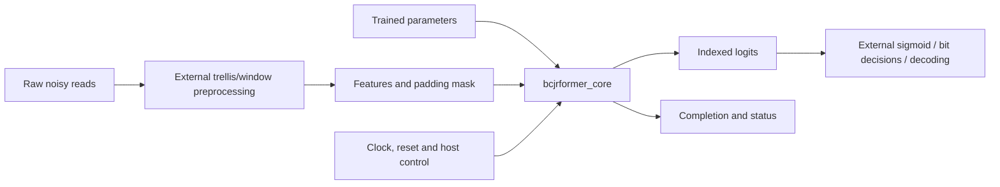

Sketch B: simulation boundary. The checker never obtains its expected values
from DUT results.

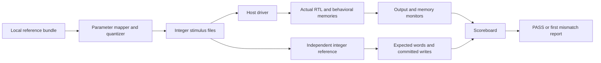

Use the ordered production list [files.f](../rtl/protocol/files.f). The existing
[core_sim_top](../rtl/tests/core_sim_top.sv) exposes flat host signals and committed
scratch writes; it can be reused by an event-driven SystemVerilog testbench.
Its host index is 16 bits. A direct host instance needs at least 8 bits for N=144.

## 2. Selected reference examples and dimensions

The local `Haiel-input/hardware_csv/hardware_csv` bundle is the candidate reference.
Its manifest identifies checkpoint epoch 94. The older attention archive has
different samples and must not supply expectations for these frames. Keep the
bundle, checkpoint and upstream source local; do not commit them with this guide.

| Symbol | Meaning | Candidate value |
|---|---|---:|
| F | Features per token | 27 |
| M | Read slots per frame | 1 |
| N | Positions per read | 144 |
| L | Tokens, M*N | 144 |
| D | Embedding width | 96 |
| H | Attention heads | 8 |
| d | Features per head, D/H | 12 |
| K | Encoder layers | 6 |
| 4D | FFN hidden width | 384 |

There are 10 independent examples, not 10 concurrent hardware lanes. The original
input shape is `[10,1,144,27,1]`; flatten window/feature axes into F exactly as
the software does. Each frame supplies 3,888 features and 144 mask bits and should
return 144 logits if execution succeeds. All reference mask bits are zero.
The raw read lengths vary from 136 to 146; they are not the feature-stream length.

The parameter CSV has 106 tensors and 687,991 scalar values, matching the core's
capacity formula for these dimensions. This is a layout/count consistency check,
not evidence of completed fixed-point or RTL validation.

### Meaning of the expected output

| Reference | Purpose | Acceptance rule |
|---|---|---|
| Integer reference logits | Verify RTL implementation | Exact signed-word equality |
| Integer reference committed writes | Locate first internal divergence | Exact bank, address, format-aware value and event order |
| Floating-point software logits | Evaluate quantization and approximation | Report maximum error, RMSE and bit changes; tolerance not frozen |
| Transmitted target bits | Measure decoding quality | Report data-bit and marker-bit errors separately |

There are 96 data/codeword positions and 48 marker positions per example; they
are not the original 48 message bits. For these examples, six data bits followed
by marker `[0,0,1]` repeat 16 times. The CSV decision convention is `logit >= 0`.
Software agreement and decoding accuracy are separate results.

Do not create the RTL expectations by rounding final floating-point logits.
All intermediate fixed-point conversions affect the final answer.

## 3. Proposed vector package

These filenames are a proposed contract, not currently generated deliverables.
Use one immutable export directory per reference/configuration revision.

```text
manifest.json
parameters.hex
sample_00/features.hex
sample_00/mask.hex
sample_00/expected_logits.hex
sample_00/expected_completion.json
sample_00/expected_writes.jsonl       # optional streamed internal comparison
... sample_01 through sample_09 ...
```

| File | Encoding and order |
|---|---|
| parameters.hex | One four-digit hexadecimal 16-bit word per line; ascending native parameter address |
| features.hex | Same word encoding; read, position, feature order with feature varying fastest |
| mask.hex | One 0 or 1 per line; read, position order; 1 means padded/invalid |
| expected_logits.hex | One 16-bit word per position; generated by integer reference |
| expected_completion.json | Expected completion code, position semantics and output count; status-check policy |
| expected_writes.jsonl | Proposed records: ordinal, bank, address, request format and normalized stored bits |

Negative words use two's complement. `$readmemh` loads bit patterns; the checker
must compare signed 16-bit values. For example, -1.0 is raw -1024, encoded `fc00`.
Text words are not byte-addressed or byte-swapped. Input ordering is:

```text
token = read_index * N + position
feature_address = token * F + feature_index
mask_address = token
```

Parameter/feature quantization is nearest, ties to even, followed by signed16
saturation: `raw = clamp(RNE(value * 1024), -32768, 32767)`. Reject nonfinite values
and record clipping counts. Python's/other languages' default rounding must be
checked rather than assumed equivalent. Stored real value is `raw / 1024`.
Internal formats differ: scores F20, probabilities F22, GELU/hidden F22; do not
apply the input quantizer to every intermediate tensor.

The manifest should record source hashes, dimensions, tensor name mapping,
quantization rule, vector lengths, file hashes, source RTL revision, reference
revision, mask/aggregation policy and expected completion. Keep paths portable.

### Parameter mapping

Use [parameter_manifest.py](../rtl/scripts/parameter_manifest.py) to establish
canonical offsets. Its tensor input accepts raw integers; it does not quantize
the checkpoint. Reorder tensors by name, never by CSV occurrence alone.
All matrices use row-major `weight[out,in]`.

| Software tensor/prefix | Canonical tensor/prefix |
|---|---|
| to_patch_embedding.0.weight / bias | embedding.norm_f.gamma / beta |
| to_patch_embedding.1.weight / bias | embedding.linear.weight / bias |
| to_patch_embedding.2.weight / bias | embedding.norm_d.gamma / beta |
| pos_embed | position |
| seq_embed.weight | read_embedding |
| decoder.layers.i.pre_norm_attn.norm.weight / bias | layer.i.ln1.gamma / beta |
| decoder.layers.i.pre_norm_ff.norm.weight / bias | layer.i.ln2.gamma / beta |
| decoder.layers.i.attn.to_q / to_k / to_v / to_out.0 | layer.i.q / key / value / out |
| decoder.layers.i.ff.net.0 / net.3 | layer.i.ffn1 / ffn2 |
| oned_final_embed.0.weight / bias | final.weight / bias |

Projection and FFN prefixes retain `.weight` and `.bias`. Require every source
tensor to map exactly once, verify shapes, reject unknown/missing tensors and
require the final image to contain exactly PARAM_WORDS words.

## 4. How the testbench inserts data

Sketch A: transaction order, repeated for each frame after one parameter load.

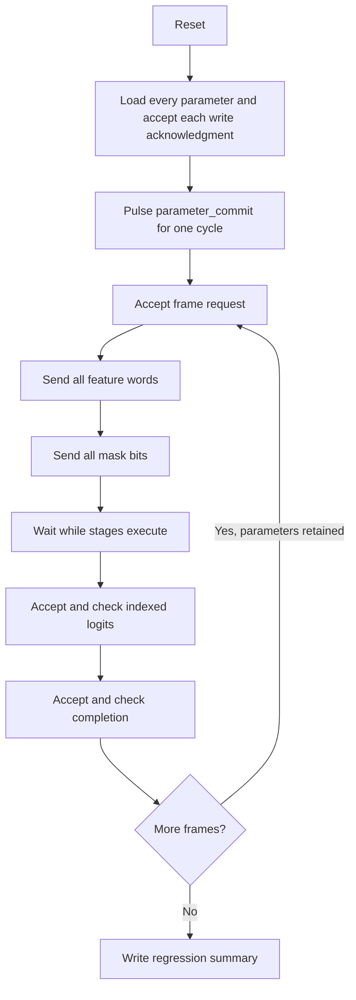

Sketch B: one ready/valid transfer. A transfer occurs only at a rising clock
edge with both valid and ready true.

```text
clock edge             e0       e1       e2       e3
producer valid          1        1        1        0
consumer ready          0        0        1        -
payload                 A        A        A        -
accepted                no       no       YES      no
```

1. Initialize every DUT input. Assert synchronous active-high reset across clock
   edges, then release it without racing a DUT sampling edge.
2. Drive `param_valid`, `param_addr`, `param_data`; keep them stable until accepted.
   Drop request valid after acceptance. Wait for `param_rsp_valid && param_rsp_ready`
   and require `param_rsp_error==0` before sending the next ascending address.
3. After the final acknowledgment handshake, pulse `parameter_commit` in IDLE.
   It has no ready signal; do not combine it with a parameter request or active frame.
4. Hold `frame_valid` until `frame_ready` accepts it; then deassert.
5. Send exactly F*M*N accepted feature words. `feature_last` is true only for
   the last accepted word. Hold data/last/valid stable during a stall.
6. Send exactly M*N accepted mask bits, with `mask_last` only on the last bit.
   The controller accepts features before masks; do not wait for mask readiness
   before finishing features.
7. Independently monitor every accepted output and completion throughout the run.
   Check `logit_index` is 0..N-1, no duplicates/gaps, `logit_last` only at N-1,
   exact signed payload and completion after the expected output count.
8. For normal frames require COMPLETION_OK, no completion error and no protocol
   or numerical error. Rounding/saturation are nonfatal; report them separately.
9. Start the next frame only after accepted completion and renewed frame readiness.
   Reset invalidates the parameter image, so reset recovery requires reload/commit.

Use clocking blocks or a documented drive/sample schedule to avoid testbench/DUT
edge races. Check unknown control and accepted payload bits with `$isunknown`;
never silently convert X/Z to zero. Use case-aware comparison for expected words.
Do not require every uninitialized memory bit to be known before it is written.

## 5. Two sketches for each processing stage

These are logical data-flow and verification views, not duplicated hardware.
Stages execute sequentially. Tensor arrows describe memory-backed dependencies;
successful stage completion follows acknowledged destination writes.

### Stage 1: embedding

Input: FEATURE `[L,F]`. Parameters: F-wide normalization, F-to-D projection,
D-wide normalization. Output: X `[L,D]`, signed16/F10.

Sketch A: data flow.

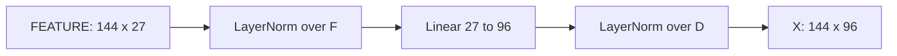

Sketch B: validation cuts.

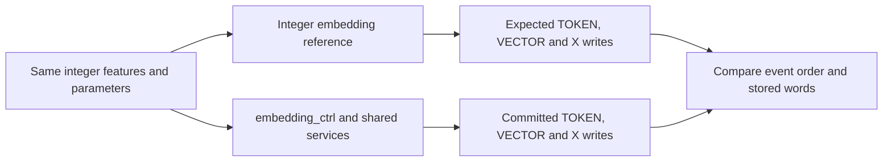

Check population variance, epsilon/RSQRT domain, affine parameters, rounding and
in-place workspace use. Match the RTL normalization contract, not default float math.

### Stage 2: position and read embeddings

Input/output: X `[L,D]`. Parameters: position `[N,D]`, read embedding `[M,D]`.

Sketch A: data flow.

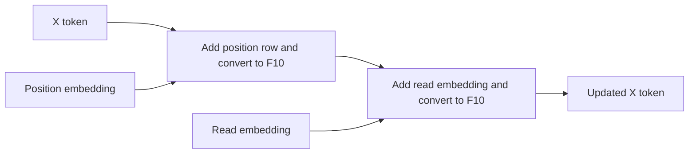

Sketch B: validation cuts.

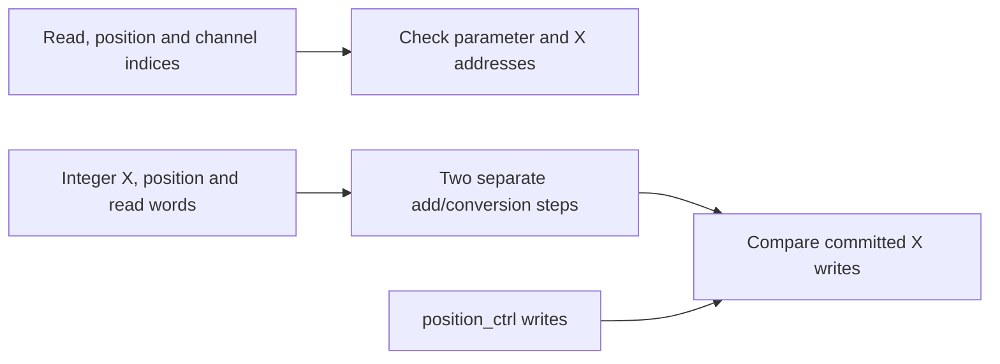

Preserve both conversion boundaries. One wide sum followed by one conversion
can differ when the first addition saturates.

### Stage 3: encoder layers

Input/output: X `[L,D]`. One physical layer controller executes K=6 iterations.

Sketch A: one logical layer; repeat for layer indices 0..5.

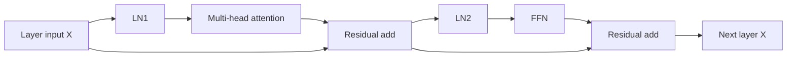

Sketch B: validation cuts.

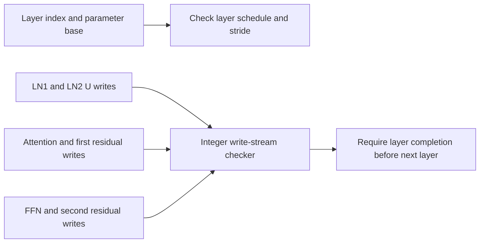

The layer parameter region is `12*D*D + 13*D` words. Check both residuals and
the parameter base for each layer, not only final encoder X.

### Stage 4: final projection

Input: X `[L,D]`. Parameters: weight `[1,D]`, bias `[1]`.
Output: LOGIT `[L]`, signed16/F10, before aggregation.

Sketch A: data flow.

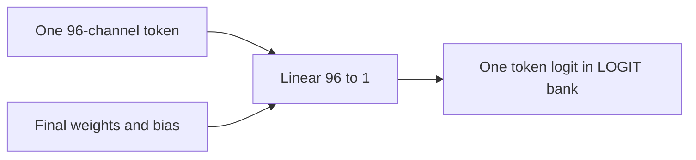

Sketch B: validation cuts.

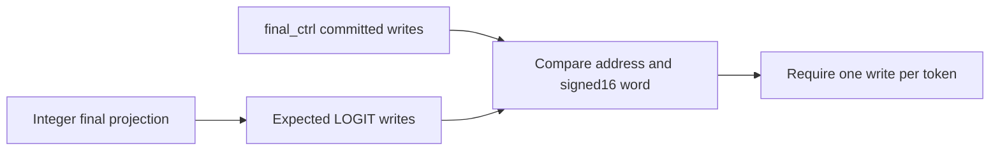

Do not apply sigmoid inside the RTL reference or expect bits on the host port.

### Stage 5: aggregation and publication

Inputs: LOGIT `[M,N]` and MASK `[M,N]`. Output: OUTPUT `[N]`, then host logits.
For these M=1 unpadded examples the stored output should equal each token logit.

Sketch A: data flow.

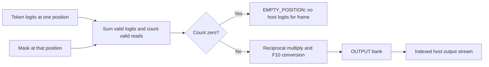

Sketch B: validation cuts.

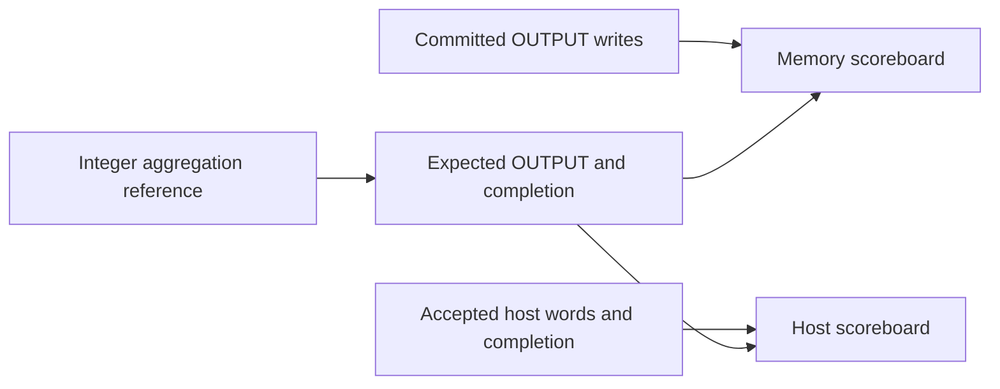

The general RTL averages using a rounded reciprocal, then rounds the product.
It is not always identical to a single exact rounded division; preserve the
[documented caveat](reviews/RTL-POST-FIX-CRITICAL-REVIEW-2026-10-17.md).
For a zero-valid-read position, partial internal OUTPUT writes may exist, but
the core publishes no host logits for that frame. Test multiple-read and empty
positions separately; the current examples do not cover them. The supplied
software's general aggregation policy differs from this RTL contract.

## 6. Inside an encoder layer

### Attention block

Input: LN1 output U `[L,D]`. Output: ATTN_OUT `[L,D]`, before residual addition.
Heads reuse the score/EXP/probability row workspaces.

Sketch A: arithmetic flow.

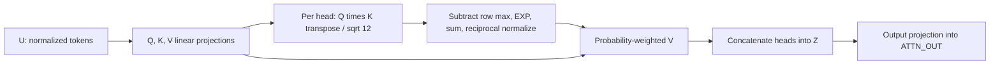

Sketch B: verification cuts.

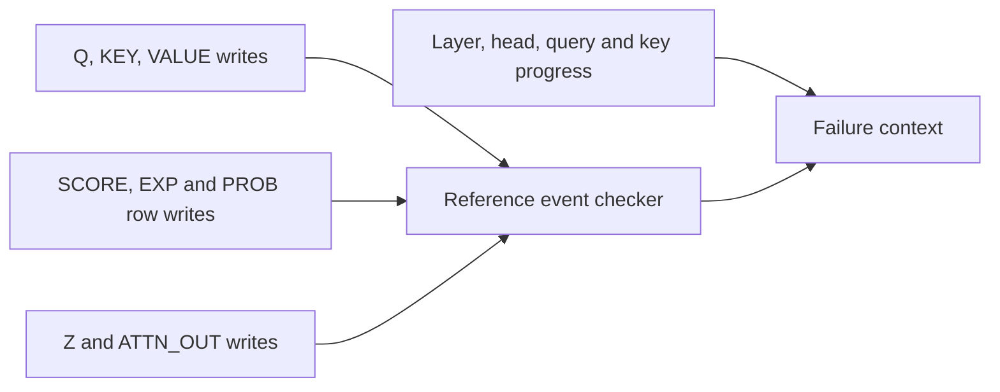

Check eight heads of width 12, scaling, row-max subtraction and formats. The
source padding convention masks queries: padded queries receive uniform rows;
valid queries retain all keys. Static attention masks are unsupported by this
core. The reviewed examples reproduce with all-key attention, but their all-zero
padding masks cannot validate padded-query behavior. The local NPZ's Q/K/V
projection inputs/outputs are float comparison points, not integer goldens.

### Feed-forward block

Input: LN2 output for one token, 96 channels. Output: 96 channels before residual.
The hidden bank is a reused 384-element workspace, not `[L,384]` storage.

Sketch A: precision flow.

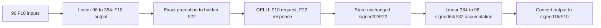

Sketch B: verification cuts.

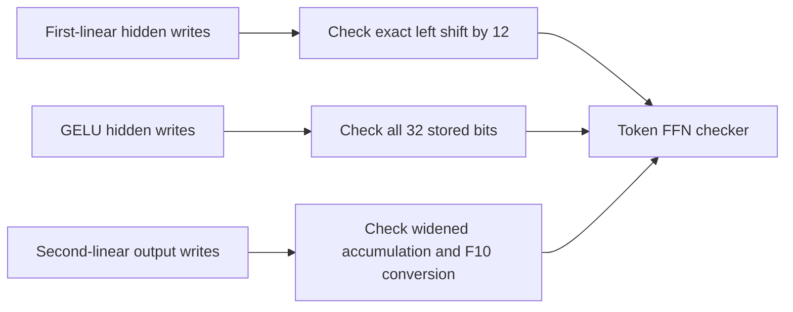

The promoted first-linear result must be exactly representable as an F10 GELU
request. Do not truncate GELU responses back to F10 before the second linear.

### Shared services, routing and memories

These are physical shared resources, not new copies per stage, head or layer.
See the [connection inventory](../rtl/RTL-CONNECTIONS.md) for every endpoint.

Sketch A: command and storage structure.

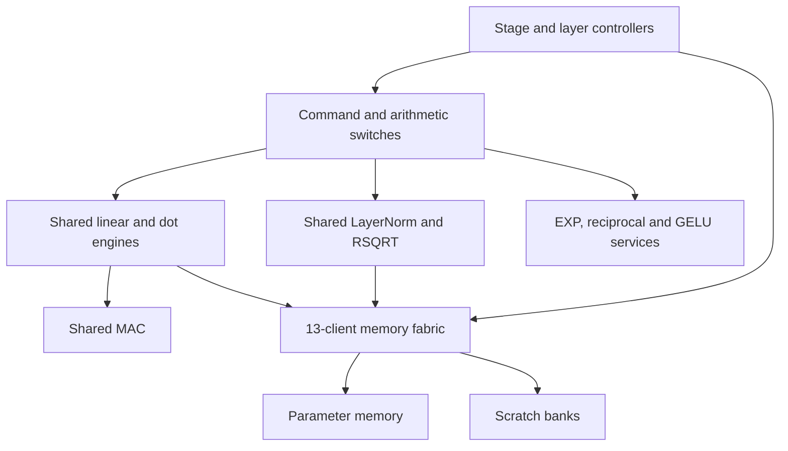

Sketch B: service-level verification. Apply this pattern separately to LayerNorm,
linear, dot, MAC, EXP, reciprocal, RSQRT, GELU, switches and memory adapters using
their actual request/response types.

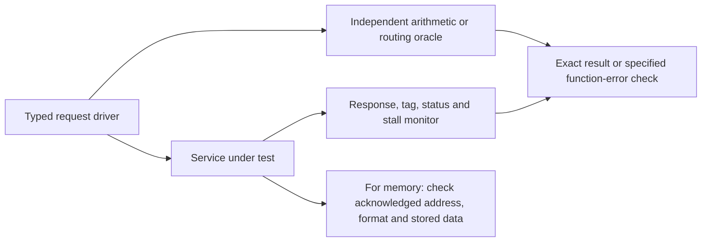

Check ownership/tag preservation, stable held responses, reset cancellation,
legal numerical domains, error propagation and write completion barriers.
Fixed-priority arbitration and finite-stall tests do not prove general fairness
or completion when an endpoint never responds.

## 7. Scoreboards, reports and practical limits

Maintain independent monitors during input driving, execution and output stalls.
Check accepted transfers, not just asserted valid. Include a global watchdog
and phase-specific timeouts with the current transaction and controller context.
No full-size cycle budget has been measured; derive limits from an initial run
and conservative operation/service latency analysis, not a small-fixture limit.

The internal checker must compare committed writes, not requests that can stall.
Normalize stored bits by bank and request format: first-linear F10 writes to
the native hidden bank become F22; GELU F22 writes retain all bits. Scratch rows
are overwritten many times; final memory snapshots alone miss earlier errors.

The existing [fixed reference](../rtl/tests/fixed_reference.py) records all events
in a Python list and covers fixture data. Adapt its input path and use streamed
or selectable checkpoints for the full model. It is not already a scalable
trained-model vector generator. Independently cross-check parameter mapping
and arithmetic at selected cuts to reduce common mistakes between exporter and oracle.

Full-size execution is substantially larger than existing fixtures. Start with
small known fixtures, then one full frame, then ten. Keep waveforms disabled or
selective by default; record focused signals/windows when investigating failures.
Behavioral memories and an arbitrary simulation clock do not establish Tower
SRAM feasibility, timing closure, area, power or maximum frequency.

Each run should report:

- Simulator/version, compile options, RTL revision and stimulus/reference hashes.
- Per-frame accepted input/output counts, cycle count and completion/status.
- First mismatch: sample, event ordinal, bank, address, format, expected/actual
  signed value and raw bits; layer/head/token context where available.
- Exact RTL/reference pass/fail separately from float error metrics and decoding BER.
- Protocol/X checks, stall/reset scenarios executed and timeout outcome.

A zero-mismatch output report alone is insufficient if the frame never completed,
too few vectors were loaded, or a checker never observed the intended transactions.

## 8. Work sequence and lab handoff

| Step | Deliverable | Exit condition |
|---|---|---|
| 1 | Confirm simulator/version, setup and source-list options | Production sources and wrapper compile |
| 2 | Portable self-checking SystemVerilog host testbench | Existing small fixture passes; deliberately wrong expected word fails |
| 3 | Local trained-model mapper and vector package | Shapes/counts/hashes verified; selected tensors checked independently |
| 4 | Integer expected outputs and selected intermediate cuts | All ten inputs processed; arithmetic/status limitations documented |
| 5 | One complete full-size RTL frame | All expected outputs and completion observed; runtime measured |
| 6 | Ten-frame regression and numerical comparison | Exact implementation checks and separate accuracy report |
| 7 | Directed protocol and semantic coverage | Input gaps, output/completion stalls, reset, malformed last, padding, empty positions and multiple reads checked |

The current integer reference returns outputs, completion and write events; it
does not supply a complete per-operation status oracle. Initially enforce the
fatal/nonfatal policy and report status. Add an independent flag oracle or directed
tests before claiming exact status coverage.

Ask the lab for the simulator executable/version, environment initialization,
license access procedure, compile/run example, SystemVerilog/assertion support,
waveform viewer and available runtime/storage. Proprietary process libraries are
not required for this first behavioral RTL run. Any later technology-model setup
is a separate lab-managed step.

## Related specifications

- [Architecture and source semantics](architecture.md)
- [Microarchitecture and memory barriers](microarchitecture.md)
- [Numerical formats](numerics.md) and [rounding map](rtl/RTL-ROUNDING-MAP.md)
- [Existing verification and its limits](verification.md)
- [Host/control implementation](../rtl/control/core_ctrl.sv)
- [Existing cycle checker](../rtl/tests/run_complete_cycle.cjs)
