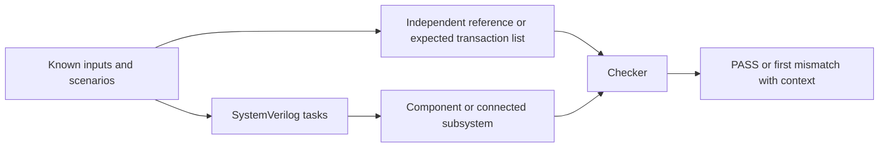
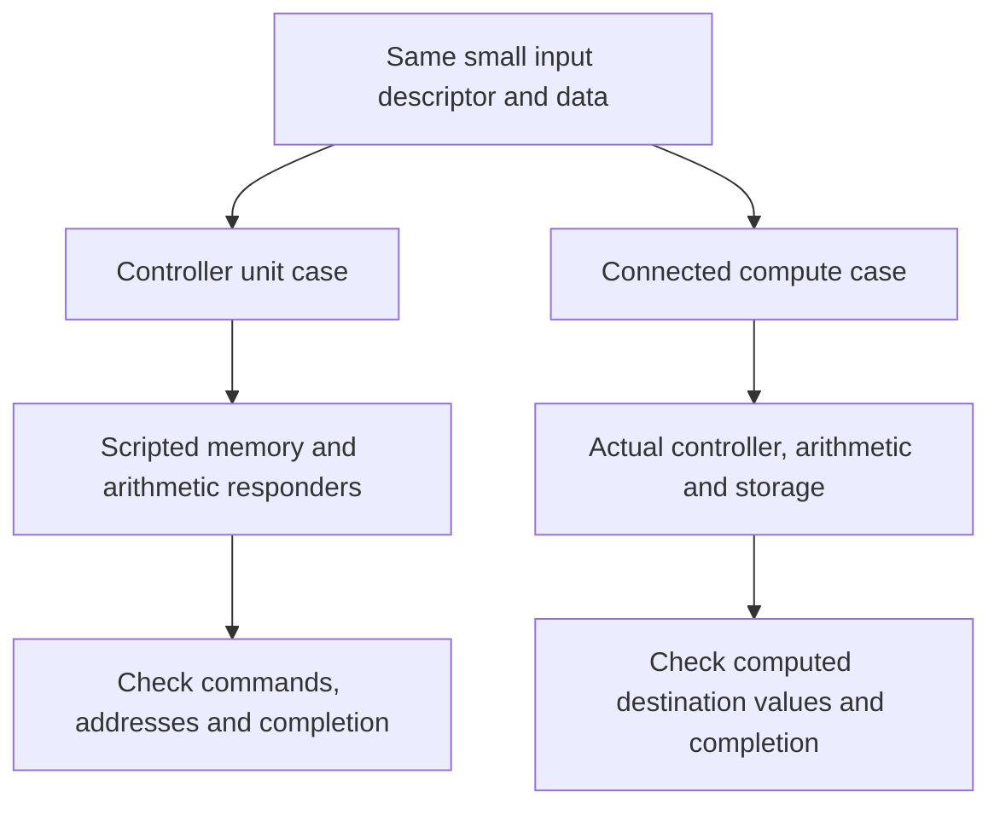
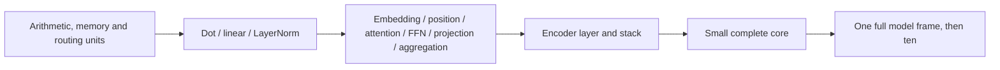

# Unit and integration testbench plan

High-level implementation plan, 31 October 2026. This document specifies proposed
ordinary SystemVerilog simulation tests. It does not introduce UVM, require a
separate verification product, or claim that the proposed benches have run in
the lab simulator. Existing cycle tests and proofs are reusable evidence and
test ideas; their execution method is described in [verification](verification.md).

## 1. What we will build

Each test has four parts: stimulus, actual RTL, an independent expected result,
and comparison. Clock, synchronous active-high reset and handshake handling are
common to all clocked benches. Expected values must not come from the DUT.

| Test level | Actual RTL included | Expected output |
|---|---|---|
| Arithmetic unit | One numerical service | Result bits, tag, flags, error |
| Controller unit | One controller, with scripted child responders | Child commands, memory transactions, completion and status |
| Memory/routing unit | Adapter, memory or switch under test | Stored/read bits, selected owner, response routing and errors |
| Connected integration | Controller plus real services and memory | Computed destination words and completion |
| Complete core | All production RTL | Indexed logits, internal writes and host completion |

A scripted responder is small testbench code that accepts a child command and
returns a scheduled response. It isolates control logic. Such a test does not
establish the child's numerical correctness; connected tests do that separately.
Controller tensors normally reside in memory, not on full-tensor ports.

## 2. Shared implementation pattern

Use a small set of reusable SystemVerilog tasks and monitors. Several unit cases
can share one bench selected by a test name; one new file per scenario is unnecessary.
The names below are proposed files under `rtl/tests/sim/`, not existing files.

| Proposed bench | Main role |
|---|---|
| tb_fixed_math.sv | Direct package-function checks |
| tb_arithmetic.sv | Arithmetic services and their response register |
| tb_memory.sv | Native storage adapters and memory wrappers |
| tb_routing.sv | Switches, transaction router and connected memory fabric |
| tb_compute.sv | Dot, linear and LayerNorm, isolated and connected modes |
| tb_controllers.sv | Parent/stage controllers with scripted children |
| tb_stages.sv | Actual stage/attention/FFN arithmetic and memory integrations |
| tb_core.sv | Small complete-core fixture, then trained-model frames |

Implementation steps for each case:

1. Instantiate the named DUT with explicit small, legal parameters. Initialize
   all driven inputs, reset it, and prepare expected transactions/results.
2. Drive one request using a task that holds valid and payload until acceptance.
   A responder uses the same rule for its response. Count transfers at clock edges
   only when both valid and ready are true.
3. Run an independent monitor while stimulus tasks execute. Compare payload,
   ordering, count, status and completion; check held values under backpressure.
4. Add a deterministic delayed/stalled run, a reset case and relevant error cases.
   Inject child errors only after an accepted child request; avoid phantom responses.
5. Report a named PASS only after all expected events occurred and completion was
   accepted. On mismatch, X/Z, missing/extra event or timeout, call `$fatal`.
6. Prove the checker is active by changing a golden value or expected command in
   a separate negative-check run and requiring failure. Do not keep corrupted goldens.

Use clocking blocks or an explicit drive/sample schedule to avoid edge races.
Check meaningful accepted payloads/control for X/Z rather than coercing them to
zero. Memory contents need not be known before initialization. Log the test name,
seed, dimensions, vectors/reference hashes, RTL revision and simulator version.
Use bounded, reproducible stalls; a watchdog detects a hang but does not prove liveness.

## 3. Arithmetic unit tests

All numerical widths below use total bits / fractional bits. Tags are echoed
unchanged; result/status/error must remain stable until accepted. Exact RTL
comparison uses an integer oracle. Floating-point function-error measurements
are separate checks against the represented input.

| ID / RTL under test | Input | Expected output | Initial cases and implementation |
|---|---|---|---|
| A01 `fixed_math_pkg` | Integer values, conversion shifts/widths and helper arguments | Rounded/clipped value, flags and helper constants | Call functions from tb_fixed_math; use independent integer vectors for ties-even of both signs, endpoints, clipping, overflow and configuration constants. Reuse conversion-proof cases. |
| A02 `mac_unit` | `mac_req_t`: mode, A, signed16/F10 B and accumulator; tag | Mode-dependent accumulated product in 64-bit response and status | Use Python big-integer goldens for all three modes; zero, negative products, 48/64-bit overflow, reserved mode, nonzero unused A bits and invalid accumulator. |
| A03 `position_add_unit` | Two signed16/F10 values and tag | Saturating signed16/F10 sum and flags | Zero, opposite signs, exact extrema, positive/negative clipping; no floating-point oracle needed. |
| A04 `exp_unit` | signed48/F20 shifted score and tag | unsigned24/F22 EXP result or domain error | x=0, values around -16, lower tail and illegal positive input. Compare exact Taylor-reference bits; separately measure function error versus exp. |
| A05 `gelu_unit` | signed16/F10 value and tag | signed32/F22 GELU result | Zero, both signs, neighbors of +/-6, tails and extrema. Start directed/sampled; schedule exhaustive 65,536-input sweep separately. Preserve F22 result bits. |
| A06 `reciprocal_unit` | unsigned64/F22 denominator and tag | unsigned40/F32 reciprocal and status | Unity, representable fractions, ties-even and values around the supported denominator limits; zero/out-of-domain must error. Use exact integer division oracle. |
| A07 `rsqrt_unit` | unsigned48/F32 variance and tag | unsigned32/F20 inverse root and status | Minimum/maximum legal variance and adjacent illegal inputs, exact squares and midpoint rounding. Match the configured normalization minimum. |
| A08 `arithmetic_register` | Externally supplied result/status plus operation request and tag | One captured, registered response with original tag and derived error | Change result inputs after request acceptance; captured response must stay unchanged. Hold ready low; reset pending response; check no duplicate transaction. |

Use [arithmetic_vectors.py](../rtl/tests/arithmetic_vectors.py),
[fixed_reference.py](../rtl/tests/fixed_reference.py) and the existing nonlinear
checks as starting points. Do not call the DUT package functions to generate
their own expected outputs. Legal domains come from the current RTL/configuration.

Three small numerical examples make the unit-test boundary concrete:

| Test | Raw input words | Expected raw output |
|---|---|---|
| MAC, signed16 mode | A=1024 (1.0), B=2048 (2.0), accumulator=0 | 2097152 in F20, representing 2.0; no error |
| Position add | left=32767, right=1 | 32767; saturation set, no fatal error |
| Connected LayerNorm | All source elements=1024, all gamma=1024, all beta=0 | Every destination element=0; check status separately |

These are starting cases, not substitutes for boundary, stall and reset coverage.

## 4. Memory and routing tests

| ID / RTL under test | Input | Expected output | Initial cases and implementation |
|---|---|---|---|
| M01 `memory_adapter` | Typed read/write requests: bank, native address, format, data | Acknowledgment/error; reads return correct native bits and extension | Small enabled/disabled banks; first/last/out-of-range addresses; all native widths; illegal formats/unused bits. Write then read after acknowledgment; vary response delay and stall ready. |
| M02 `parameter_mem` | PARAM-only requests | Ordered acknowledgments and retained parameter reads | Check parameter-only bank policy, reset during request and readback after reset. Reset cancels interface work; storage retention is distinct from core parameter-image validity. |
| M03 `scratch_mem` | Requests to scratch banks | Correct stored/read values and errors | Cover signed16, signed48, unsigned24, mask and signed32 hidden bank. Hidden F10 writes promote exactly by 12 bits; F22 writes preserve all bits; reject parameter-bank requests. |
| M04 `transaction_router` | Requests from multiple clients and service responses | One selected request and response to its retained owner | Unique payload/tag patterns; 1 and 13 clients; simultaneous requests; service/response stalls; reset. Check fixed priority, no misrouting/duplication and ownership until acceptance. Do not expect round-robin fairness. |
| M05 `command_switch` | Typed client commands and downstream completion/status | Correct command selection and caller completion/status | Exercise actual norm/linear/dot payload types and client counts 2/5/3; delay service, stall response, distinguish every client's payload and error. |
| M06 `arithmetic_switch` | Operand/tag requests from arithmetic clients | Selected request; result/tag/status only to its owner | Test two reciprocal callers with distinct tags; held response, error, reset and a second waiting client. |
| M07 `memory_fabric` | 13 clients issuing typed memory requests | PARAM/scratch routing or local error; response to originator | Start scripted endpoints, then connect real memories. Test unauthorized/invalid banks, addresses, formats and unused bits; competing clients and delayed/stalled responses. |

Memory scoreboards use bank-specific widths and signed extension, rather than
assuming every bank holds 16-bit activations. Observe actual commit events for
internal comparisons and response handshakes for the requester-visible contract.

## 5. Compute-controller tests

Run each row twice: first with scripted child responses to check sequencing,
then with actual arithmetic and modeled/real storage to check numerical results.

| ID / RTL under test | Input | Expected output | Initial cases and implementation |
|---|---|---|---|
| C01 `dot_engine` | `dot_cmd_t`: length, two bank/address/stride descriptors, mode and initial accumulator; operand memory | Memory reads, MAC requests, final accumulator/status | Length 1 and several elements, unequal strides, signed/probability/wide-hidden modes, bad descriptor, MAC/memory error and reset. Connected run compares sum against independent big integers. |
| C02 `linear_ctrl` | `linear_cmd_t`, input vector, row-major weights and biases | Bias reads, one dot command per output, destination writes and completion | Rectangular matrices with unique rows, nonzero bases, signed bias and clipping. Include native F22 hidden-source mode and signed64/F32 accumulation. Require acknowledgment of final write before success. |
| C03 `layernorm_ctrl` | `layernorm_cmd_t`, source vector, gamma/beta and epsilon configuration | Source/parameter reads, RSQRT request, normalized destination writes and status | Length 1, constant/mixed-sign vectors, non-power-of-two length, affine/clipping cases, aliasing supported by contract. Exact F20 mean and F32 population variance oracle; RSQRT/memory faults and reset. |

Sketch: isolating a compute controller versus connecting it.

## 6. Stage and scheduling controller unit tests

For these rows, the outputs being checked include child requests and memory
transactions. Empty command responses carry completion/status rather than tensors.
Use asymmetric tiny shapes and unique parameter bases so address swaps are visible.

| ID / RTL under test | Input | Expected output | Initial cases and implementation |
|---|---|---|---|
| C04 `embedding_ctrl` | Start command; configured F/D/token count; memory and norm/linear responses | Per-token feature copy, F normalization, projection, D normalization, X writes and completion | At least two tokens with F != D; check every descriptor/base and copy order. Delay each child, fail reads/writes/children, reset mid-token. |
| C05 `position_ctrl` | Start, X/position/read words and memory responses | Addressed X updates and completion | At least two reads/positions and multiple channels; distinguish position and read indexing; check two add/conversion steps and memory errors. Also exercises its helpers. |
| C06 `qkv_ctrl` | Layer descriptor and linear responses | Three projection sweeps into Q/KEY/VALUE, descriptors and completion | Distinct Q/K/V offsets; more than one token; layer bounds, stalls and child failure. Include wrapper configuration of projection_loop. |
| C07 `output_projection_ctrl` | Layer descriptor and linear responses | Z-to-ATTN_OUT linear sweep and completion | Verify source/destination banks, offsets, token count and layer propagation; error/reset. Include projection_loop wrapper wiring. |
| C08 `score_row_ctrl` | Head/query descriptor and dot/memory responses | Scaled signed48/F20 SCORE row writes and completion | Multiple heads/keys with unique values, head/query bounds, scale rounding, dot/memory errors and stalled final write. |
| C09 `weighted_value_ctrl` | Head/query descriptor and dot/memory responses | unsigned-probability x signed-value dot requests and F10 Z writes | Check value stride D, selected head/channel, probability-row address and conversion; errors/reset. |
| C10 `softmax_ctrl` | Query-padding command, SCORE row and arithmetic/memory responses | EXP/PROB writes and completion/status | Equal scores, large score spread, zero shifted maximum, tail underflow and padded uniform row. Check integer probabilities; do not require rounded row sum to equal exactly one. Inject bad tags/child errors where applicable. |
| C11 `attention_ctrl` | Layer descriptor, query mask reads and five child responses | QKV once; head/query score-softmax-weighted sequence; output projection and completion | Use H>1 and L>1; verify every head/query, padded-query flag, child failure and no premature completion. Its memory reads concern query padding. |
| C12 `ffn_ctrl` | `ffn_cmd_t`, first-linear hidden words and linear/GELU/memory responses | D-to-4D request, per-element GELU read/write, 4D-to-D request and completion | Check all hidden indices, exact F10 promotion, F22 storage and second-linear source. Reject malformed promoted preactivations; child tag/errors and reset. |
| C13 `residual_ctrl` | `residual_cmd_t` and two source vectors in memory | Saturating F10 vector sums, writes and completion | Distinct bases and signed values, supported aliasing, clipping, bad length/bank/extent, read/write errors and final-write stall. |
| C14 `layer_ctrl` | Layer descriptor and norm/attention/residual/FFN responses | LN1, attention, residual, LN2, per-token FFN/residual schedule and completion | Check descriptor routing, parameter offsets, token progression and dependency order; faults at each child and reset. |
| C15 `encoder_ctrl` | Start and layer responses; configured K/base/stride | Exactly K layer commands with correct indices/bases and completion | K=1 then K=2 with nonzero base; delayed response and failed intermediate layer; no next layer before accepted child completion. |
| C16 `final_ctrl` | Start and linear responses; token count, D and final parameter bases | One D-to-1 projection per token into LOGIT and completion | Distinct token addresses, final weight/bias bases, stalls, child error and reset. |
| C17 `aggregation_ctrl` | Start, per-position masks/logits and reciprocal/memory responses | OUTPUT writes plus aggregation completion code/position | One read; multiple reads; partial padding; no valid read at a position; negative/tie sums. Match rounded-reciprocal arithmetic, check valid sum/count use the same mask and final write barrier. |
| C18 `core_ctrl` | Host transactions, stage responses and memory responses | Host readiness/acknowledgments, five stage commands, indexed logits, status and completion | Load/commit/frame sequence; bad address/count/last; premature/late commit; stage fault; empty-position recovery; held output/completion; reset and required parameter reload. |

The following internal modules are included in production and need explicit
case coverage, even when exercised through their public wrapper benches:

| ID / helper | Input | Expected output | Implementation scope |
|---|---|---|---|
| H01 `position_sequencer` | Start and scripted memory/addition responses | Ordered X/P/read-embedding reads, two additions, X write and status | Direct unit instance for addition stalls/tag errors/reset; connected position_ctrl case checks actual arithmetic. |
| H02 `projection_loop` | Layer descriptor and linear responses, configured projection bank/offset arrays | Token/projection descriptor sequence and completion | Run PROJECTIONS=1 and 3, layer bounds and failure at different sweep positions; wrappers C06/C07 cover real offset selections. |
| H03 `row_dot_ctrl` | Row descriptor and dot/memory responses, WEIGHTED mode | Score or weighted-value descriptors/conversions/writes | Exercise WEIGHTED=0 and 1 via C08/C09; add direct cases for invalid head/query, conversion/error and reset boundaries. |

## 7. Connected stage tests

These use actual child arithmetic and memory. A controller unit PASS cannot
replace these numerical integration checks. Share integer vectors/reference
code where suitable, with independent small hand calculations at selected cuts.

| ID / connected subsystem | Input | Expected output and check |
|---|---|---|
| I01 Embedding | Tiny FEATURE tensor and embedding parameters | Exact intermediate normalization/projection words and X `[L,D]`; compare committed writes. |
| I02 Position | X, position and read embeddings | Updated X; explicitly test saturation in the first addition before the second. |
| I03 Attention | U, Q/K/V/output weights, layer descriptor and mask | Q/KEY/VALUE, score/EXP/PROB rows, Z and ATTN_OUT. Check head indexing and padded uniform query; static masks remain unsupported. |
| I04 FFN | One LN2 token and FFN parameters | First-linear promotion, exact GELU F22 hidden words and F10 output; include the existing GELU precision fixture idea. |
| I05 Encoder layer | X, layer parameters and mask | LN1/attention/residual/LN2/FFN/residual intermediate writes and final X. |
| I06 Encoder stack | X and at least two distinct layer parameter regions | Final X plus correct layer transitions and intermediate writes. |
| I07 Final projection | X and final weight/bias | One exact signed16/F10 LOGIT per token. |
| I08 Aggregation | LOGIT and MASK tensors | OUTPUT and completion, including empty-position behavior and reciprocal-rounding edge cases. |

Sketch: increasing integration scope.

## 8. Complete-core tests and shared scenarios

| ID / DUT | Input | Expected output | First implementation |
|---|---|---|---|
| S01 `bcjrformer_core`, small fixture | Canonical parameters, features and masks for existing `(2,2,2,2,1,2)` fixture | Exact committed write sequence, indexed logits and completion for each fixture frame | Reuse core_sim_top and existing integer fixture/goldens; drive real host load/commit handshakes. First target for simulator bring-up. |
| S02 Complete-core shape/precision cases | Existing single, asymmetric multi-head and GELU precision fixtures | Correct shape-dependent addresses, F22 precision and final results | Reuse existing fixture definitions; do not call a small fixture a trained-model test. |
| S03 Complete-core recovery | Controlled malformed host transfers/reset and valid subsequent frames | Documented fatal/reset or recoverable completion, stable held responses and valid recovery | Adapt current fault-cycle scenarios; verify parameters must reload after reset and survive recoverable empty-position completion. |
| S04 Complete-core selected model | Haiel's quantized parameters/features/masks, dimensions `(27,1,144,96,8,6)` | Integer-reference outputs exactly; separate float/bit error report | Implement exporter and scalable integer expectations first; run one frame and measure runtime before all ten. |

S01 is the first runnable lab milestone. Unit benches can be added incrementally
without postponing that simulator bring-up. The testbench host loading sequence
and local vector contract are specified in [testbench-design.md](testbench-design.md).

Apply these scenarios wherever the corresponding interface/behavior exists:

| Scenario | What the test supplies | What must be observed |
|---|---|---|
| Normal transaction | Known request/data; ready high | Exactly one expected result/completion |
| Input gaps | Valid low between transactions | Same results with no missing/extra work |
| Request/response stalls | Bounded ready-low intervals | Valid/payload stable until accepted; correct owner/order |
| Reset in flight | Reset at selected request/wait/held-response phases | Work canceled according to contract; no stale response after reset; reinitialize/reload as required |
| Invalid request | Specific illegal descriptor/format/domain | Documented error/status; no claimed successful completion |
| Child/memory failure | Error response to a previously accepted request | Error propagation and no premature successful parent completion |
| Boundary values | Counts, signs, ties, extrema and clipping cases | Exact arithmetic or address behavior and correct flags |
| Reuse | Several legal requests/frames without reset | Clean per-operation state and permitted data retention |

Not every numeric error returns a meaningful numerical payload; compare only
fields defined by the contract for an error response. Rounding/saturation flags
are nonfatal, while protocol/numeric errors are fatal in the core. Exact status
checking requires a suitable oracle: the current full-frame integer reference
does not yet predict every status event. Report that limitation explicitly.

## 9. Execution order and completion tracking

| Order | Work | Completion evidence |
|---|---|---|
| 1 | Confirm lab simulator, compile ordered production sources, implement common clock/reset/handshake tasks and S01 | Small fixture PASS and deliberate mismatch detected |
| 2 | Arithmetic A01-A08 and memory/routing M01-M07 | Directed/boundary/stall/reset cases pass with active checkers |
| 3 | Compute C01-C03 and controller C04-C18/H01-H03 isolation | Expected commands/data and fault handling checked |
| 4 | Connected I01-I08 plus S02/S03 | Real service/memory interaction, precision and recovery checked |
| 5 | S04 export/reference, one full-size frame, then ten | Exact RTL agreement and separate numerical-accuracy report |
| 6 | Broader sweeps, seeded scenarios and coverage closure | Documented coverage gaps, reproducible seeds and measured runtimes |

For each ID record: **planned**, **implemented**, **run**, then **passed/failed**,
with command, simulator, revision, cases and log path. This document starts at
planned for the new lab benches; historical checks remain separately recorded.
Coverage is a list of exercised scenarios plus available code/assertion coverage,
not a claim that every bug has been excluded. Full-size liveness and physical
timing/area/power remain outside these functional PASS results.

Also maintain compile/elaboration preflight cases: valid configurations must
elaborate, while invalid dimensions, head divisibility, bank capacities and host
index widths must fail their documented guards. Packages and interfaces are
compiled dependencies; they are not separate clocked devices. Package helper
functions are checked directly under A01.

## Existing material to reuse

- [Production source order](../rtl/protocol/files.f) and [connection inventory](../rtl/RTL-CONNECTIONS.md).
- [Typed request/response contracts](../rtl/interfaces/bcjrformer_contract_pkg.sv) and [interfaces](../rtl/interfaces/bcjrformer_channels.sv).
- [Arithmetic vectors](../rtl/tests/arithmetic_vectors.py), [LayerNorm cases](../rtl/tests/layernorm_regression.py), [integer reference](../rtl/tests/fixed_reference.py).
- [Controller fault wrapper](../rtl/tests/controller_fault_sim_top.sv) and [fault runner](../rtl/tests/run_controller_fault_cycle.cjs).
- [Complete-core wrapper](../rtl/tests/core_sim_top.sv), [cycle checker](../rtl/tests/run_complete_cycle.cjs) and [core fault cases](../rtl/tests/run_core_fault_cycle.cjs).
- Existing `run_*_suite.py`, formal harnesses and conversion/hidden-memory proofs under `rtl/tests`: retain historical evidence while porting relevant scenarios to the lab simulator.
